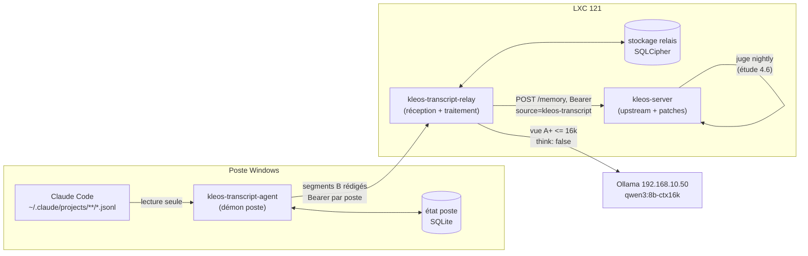

# Étude d'architecture : cible de l'ingestion des transcripts Claude Code

Statut : **conception seulement, aucun code livré**. Révision 5 du 2026-10-21 (dédup de
fond, space par session, juge amont Haiku, bande grise Sonnet, condition de licence ;
voir la table ci-dessous).
Historique : la
révision 2 répondait à un challenge au verdict « tombe » et à trois mesures (T1 à T3,
section 0) ; la révision 3 intègre le verdict du consultant sur l'embranchement de la
section 1.3 ; la révision 4 retire toute dépendance à la porte de revue. Décisions
opérateur du 2026-10-21 : R et règle de bump validées (Q5) ; **la porte de revue
(`KLEOS_REVIEW_GATE_*`, statut `pending`, inbox) ne sera jamais activée** (21:57, Kleos
#31722), donc la variante (a') et la carte 6ee2297f sont abandonnées. La protection
contre les faits faux passe par le relais et par le juge (section 4.4). Cette étude détaille la section 4.3 de
l'[étude nightly](2026-10-20-kleos-nightly-pipeline.md) (« Transcripts en attente :
extension distincte ») et en **amende un point** : la zone `transcript_staging` ne vit
pas dans Kleos (overlay Patch 41) mais dans un relais à côté du serveur, dépôt séparé
dépendant de kleos-lib par un rev épinglé (tranché par le consultant, section 1.3). Le reste
de l'étude nightly (juge de voisinage, état de traitement, principe « un faux retrait
est pire qu'un retrait manqué ») s'applique tel quel aux mémoires issues des
transcripts.

Cartes liées : `f18dc3c4` (mise en service), `20d18577` (reprise après arrêt brutal),
`3f45e0f8` (portage Windows, livré), `19671bc8` (dry-run du watcher), `6ee2297f`
(dédup et porte d'attente, archivée en wontfix le 2026-10-21).

### Ce que les révisions 2 à 5 changent

| Point du challenge, du consultant ou de l'opérateur | Réponse | Section |
|---|---|---|
| (1) Une ligne `pending` absorbe les stores ultérieurs de l'agent | **Sans objet depuis la révision 4** : la porte ne sera jamais activée, aucune ligne `pending` n'est écrite | 4.4 |
| Opérateur (révision 5) : dédup de fond comme couche principale contre le transcript publié avant l'agent ; space par session ; juge cloud admis ; licence upstream | Niveau déterministe déjà assuré par le Patch 60 à 0,9, bande grise [0,80 ; 0,90[ jugée par Sonnet dans le relais (décision opérateur du 2026-10-22, 4.8), file `to_dedup` en table du relais ; résiduel réécrit (le mauvais ordre n'existe qu'au-delà de 8 h) ; space résolu sur le poste depuis le fichier de session du hook ; juge amont Haiku ; rev épinglé conditionné au gel ELv2 | 1.3, 4.4, 4.5, 4.8, 8, Q5 |
| Opérateur (révision 4) : pas de porte ; des faits de Qwen peut-être faux seraient servis dès publication ; aucune relecture humaine possible | Protection autonome à zéro delta en quatre couches : juge amont dans le relais (fidélité et voisinage) avant toute publication, importance plafonnée à 5, provenance par source et tags, juge nightly qui archive a posteriori ses seules mémoires de transcript. Les couches 1 à 3 bloquent la mise en service, la couche 4 et le nettoyage des mémoires d'agents non | 4.4, 4.6, 4.7 |
| (2) La règle « non révisé après 45 min » ne tient pas à la reprise | Parade : état par lignée hérité à la reprise, publication à la stabilisation (8 h), révision des faits publiés par la chaîne de versions de Kleos | 4.2, 4.3 |
| (3) Coût du relais sous-estimé : secrets, chiffrement, authentification | Parade pour chacun, coût chiffré ; limite nommée : la rédaction des secrets est incomplète par nature | 1.4 |
| (4) Le budget Ollama ignore `KLEOS_LLM_THINK` | Parade : `think: false` explicite et rejet des réponses tronquées ; budget recalculé sur T2 | 3.2, 4.2 |
| Idée du challenger : stocker B, ne présenter que A+ au modèle | Retenue | 3.2 |
| Consultant (révision 3) : R, mais le relais dépend de kleos-lib par un rev épinglé | Intégré : E3 et E7 neutres, effort de 1.4 ramené à 0,5 à 1 jour, lot F de gel avant tout code | 1.3, 1.4, 8, Q5 |

### Légende des étiquettes

- **MESURÉ (rapporté, #id)** : mesure faite par l'opérateur ou un autre peer, consultée
  dans Kleos pour cette étude, non réexécutée ici.
- **MESURÉ** sans mention : commande lancée pour cette étude.
- **DÉDUIT** : raisonnement sur du code lu, avec `fichier:ligne`.
- **SUPPOSÉ** : non vérifié. Une porte de lot (section 8) le transforme en mesure quand
  il porte une décision.

---

## 0. Faits d'entrée

| # | Fait | Étiquette |
|---|---|---|
| F1 | 4 751 fichiers `.jsonl`, 7,0 Go ; fichier max 60 Mo, p90 3,5 Mo ; flux moyen environ 300 Mo par jour sur 8 jours, pic 562 Mo ; sous-agents 10 % du stock | MESURÉ (rapporté, #31675) |
| F2 | La conversation utile (texte user + texte assistant) pèse 5 à 9 % des octets ; `attachment` 29 %, `api-request*` 16,7 %, `thinking` environ 7 % | MESURÉ (rapporté, #31675) |
| F3 | Purge complète : environ 14,7 % restent avec `tool_use`/`tool_result`, 2,0 % sans eux (texte assistant 1,89 %, texte user tapé 0,13 %) ; soit environ 44 Mo ou 6 Mo par jour. 73 % du texte user est injecté par le harnais | MESURÉ (rapporté, #31699) |
| F4 | Curseur = offset d'octets : 9,8 % des lignes datées ont un timestamp non monotone, 29 % des lignes n'ont pas d'uuid | MESURÉ (rapporté, #31676) |
| F5 | `/compact` écrit `compact_boundary` et une ligne user `isCompactSummary` dans le MÊME fichier ; reprise ou fork recopie l'historique dans un nouveau fichier avec les MÊMES uuid sous un nouveau `sessionId` (100 paires de fichiers) ; sous-agents sous `<projet>/<sessionId>/subagents/` | MESURÉ (rapporté, #31676) |
| F6 | Le caractère « ajout seul » des fichiers n'est pas prouvé : second passage de comparaison à faire | DÉDUIT (rapporté, #31676) |
| F7 | kleos-ingest sur 20 vrais transcripts : 541 candidates, environ 2 utiles sur 20, injections du harnais prises pour du texte user ; le résumé couvre 1,7 % de la conversation en moyenne, 0,4 % sur 59 Mo | MESURÉ (rapporté, #31682) |
| F8 | Le résumé lit depuis la première ligne et s'arrête à 3 000 caractères, `max_tokens` 300 | DÉDUIT (rapporté, #31653, `kleos-ingest/src/summarizer.rs:16-67`) |
| F9 | Le classifieur du mode auto refuse aux agents la lecture analytique des transcripts : toute mesure sur les transcripts réels est un geste opérateur | MESURÉ (rapporté, #31658) |
| F10 | Cible LLM serveur : `qwen3:8b-ctx16k`, contexte 16 384 tokens, sur Ollama 192.168.10.50 | DÉDUIT (`CLAUDE.local.md`, section Cible LLM) |
| **T1** (historique, sans objet depuis la révision 4) | Porte active, `KLEOS_REVIEW_GATE_SOURCES=kleos-transcript` : un store `claude-session` quasi identique à une ligne `pending` rend `created=false, duplicate_of=<id pending>` ; aucune ligne approuvée n'est créée | MESURÉ (rapporté, #31707, test d'intégration jetable) |
| T1-a | Cause : la requête de dédup exclut `is_archived = 1` et `status = 'rejected'`, pas `pending` ; le chemin doublon rend l'id existant sans toucher la ligne | DÉDUIT (`kleos-lib/src/memory/mod.rs:586-590`, `:607-616`) |
| T1-b | En production, `/etc/kleos/kleos.env` ne contient aucune variable `REVIEW_GATE` ; `KLEOS_REVIEW_GATE_ENABLED` vaut `false` par défaut : **la porte est éteinte aujourd'hui** | MESURÉ (rapporté, brief du lead) ; défaut DÉDUIT (`mod.rs:777-781`) |
| **T2** | `qwen3:8b-ctx16k` par `/api/chat`, fenêtre de 36 000 caractères = 9 084 tokens, raisonnement coupé : ingestion du prompt à froid 6,2 s (environ 1 470 tokens/s), génération environ 49 tokens/s ; environ 12 s pour 300 tokens de sortie, 22 s pour 800. Un préfixe identique est servi par le cache KV (18 à 46 ms), donc un appel répété sous-estime le coût réel. Avec `think: true` et `num_predict` 800, le budget part dans le raisonnement et l'appel s'arrête en `length` | MESURÉ (rapporté, #31706) |
| T2-a | La production pose `KLEOS_LLM_THINK=0`, mais cette variable est lue par kleos-server (Patch 14) ; un processus séparé n'en hérite pas | MESURÉ (rapporté, brief du lead) ; héritage DÉDUIT (`CLAUDE.local.md`, section Cible LLM) |
| **T3** | 687 sessions actives sur 14 jours : 28,97 % ont au moins un écart de plus de 45 min suivi d'autres tours ; 18,05 % à 60 min, 7,71 % à 2 h, 0,73 % à 8 h. En ne comptant que les prompts tapés par un humain : 14,41 % à 45 min, 0,58 % à 2 h. La moitié des reprises sont déclenchées par un message injecté (canal peer, notifications). Les 355 écarts de plus de 45 min : médiane 55 min, p90 170 min | MESURÉ (rapporté, #31716) |
| T3-a | Lignée resume/fork : 6 copies sur 687 sessions ; la copie démarre p50 16 min après la source ; 2 cas sur 7 au-delà de 45 min ; aucune source n'a continué après le fork | MESURÉ (rapporté, brief du lead ; le brief donne 6 copies et 7 cas, écart non résolu ici) |
| F11 | `POST /memory` désérialise `StoreRequest` tel quel : `parent_memory_id`, `created_at`, `space`, `session_id`, `tags` et `sync_id` passent par l'API publique ; corps limité à 256 Kio | DÉDUIT (`kleos-server/src/routes/memory/mod.rs:74`, `:110-136` ; `kleos-lib/src/memory/types.rs:306-342`) |
| F12 | Un store avec `parent_memory_id` crée la version suivante, passe l'ancienne à `is_latest = 0`, saute la dédup, et **refuse** (`Conflict`) si le parent n'est plus la tête de chaîne | DÉDUIT (`mod.rs:578`, `:855-890`) |
| F13 | La porte de revue ne sera jamais activée ; l'inbox d'approbation existe et se consulte depuis l'interface web GUI de Kleos, pas depuis kleos-cli ni le serveur MCP | Décision opérateur du 2026-10-21 (Kleos #31722) |
| F14 | Tiers servis sans requête : le tier « important » de `/recall` prend `importance >= 7` (`RECALL_IMPORTANT_MIN`, `kleos-server/src/routes/memory/mod.rs:681`, appel `:770`) ; `/context` ne remonte d'office que les statiques d'importance au moins 9 (`kleos-lib/src/context/mod.rs:601`) et les insights d'importance au moins 8 (`kleos-lib/src/context/deps.rs:117`) | DÉDUIT (lignes lues) |
| F15 | Filtres de lecture existants : `source_filter` et `tags` sont des filtres **positifs** (égalité de source, `kleos-lib/src/memory/search.rs:1543-1575`) ; aucun filtre d'**exclusion** par source n'existe. Seules les catégories `activity` et `growth` sont exclues par défaut de la recherche (`search.rs:1101-1107`) | DÉDUIT (lignes lues) ; absence d'un filtre d'exclusion SUPPOSÉE (lecture de `search.rs` seulement) |
| F16 | La dédup de fond (Patch 60) garde l'importance la plus haute, et à égalité l'id le plus haut | DÉDUIT (`docs/dev-notes/local-patches.md:6606-6613`) |

---

## 1. Composants et frontières

### 1.1 Vue d'ensemble

Le schéma montre l'option R (relais séparé). Dans l'option S (section 1.3), le bloc
« relais » devient un module de kleos-server et son stockage des tables overlay ; le
démon et son protocole ne changent pas.



### 1.2 Qui détient quoi

| Composant | Détient | Ne détient jamais | Écart upstream (table CLAUDE.md) |
|---|---|---|---|
| Claude Code | Les transcripts bruts, seule copie complète | | hors périmètre |
| Démon poste `kleos-transcript-agent` | Curseur par fichier (offset acquitté, époque, empreintes), version de purge du fil. **Aucune copie** du transcript : le fichier source sert de tampon | Contenu purgé persistant, mémoires, appel LLM | **Zéro delta** si dépôt séparé (Q5) |
| Relais `kleos-transcript-relay` | Enregistrements B rédigés (rétention 14 jours), index des uuid (longue durée), état de lignée, résumés de fenêtre et de session, faits candidats, correspondance fait vers id et version Kleos | Les mémoires canoniques, l'autorité de retrait sur une mémoire qu'il n'a pas écrite | Option R : **zéro delta**. Option S : voir 1.3 |
| kleos-server | Mémoires canoniques, chaîne de versions, archivage réversible, voisinage et annotations de l'étude nightly | Le transcript, même réduit (option R) ; aucune mémoire de transcript en statut `pending` (F13) | **Zéro delta** pour la cible : publication, révision, recherche des voisins et archivage passent par l'API existante (4.4) |
| Ollama | Rien de persistant | | hors périmètre |

### 1.3 Embranchement pour le consultant : relais séparé (R) contre staging dans Kleos (S), tranché R

> Ce passage est autonome : il peut être lu sans le reste de l'étude.

**La question.** Les segments de transcript envoyés par le démon poste, leur état de
traitement et les faits candidats doivent vivre quelque part sur LXC 121, pendant 14
jours, avant que des faits n'en sortent vers les mémoires Kleos. Deux emplacements :

- **R, relais séparé** : un binaire et un service systemd distincts, dans un dépôt
  séparé, avec une base propre. Il publie dans Kleos par l'API HTTP publique et
  **dépend de kleos-lib par une dépendance git épinglée sur le fork VOCSAP** (prémisse
  corrigée par le consultant, voir « Verdict » ci-dessous), sans entrer dans les
  `members` du `Cargo.toml` racine.
- **S, staging dans Kleos** : des tables ajoutées par le canal overlay Patch 41
  (`kleos-lib/src/db/vocsap/mod.rs`), des routes de réception et un job de traitement
  dans kleos-server, déclenché par le dreamer.

**Ce qui ne dépend pas du choix.** Le démon poste, son protocole (curseur, époque,
idempotence par `(file_key, epoch, start)`, réponses 409, section 2), la règle de purge,
le fenêtrage et la règle de publication sont identiques dans R et S. Le démon est
la partie la plus délicate (Windows, arrêts brutaux, F4 à F6) : **si le contrat HTTP
démon vers serveur est figé d'abord, l'embranchement n'engage que le côté serveur.**

**Faits qui pèsent.**

| # | Fait | Étiquette | Penche vers |
|---|---|---|---|
| E1 | L'API publique accepte tout ce que la publication demande : `parent_memory_id` (révision), `created_at` (date du tour), `space`, `session_id`, `tags` | DÉDUIT (`routes/memory/mod.rs:110-136`, `types.rs:306-342`) | R : aucun accès interne requis |
| E2 | La révision d'un fait publié passe par la chaîne de versions, qui refuse un parent périmé | DÉDUIT (`memory/mod.rs:855-890`) | neutre : disponible en R par l'API, en S par appel direct |
| E3 | Le réglage du raisonnement et la résolution `prompts-overrides` sont des fonctions publiques de kleos-lib : `llm::think_setting` lit `KLEOS_LLM_THINK` (`kleos-lib/src/llm/mod.rs:45`), `llm::prompts::load_prompt` applique la cascade et le cache (`kleos-lib/src/llm/prompts.rs:97`). Avec le raisonnement actif, l'appel s'arrête en `length` (T2) | DÉDUIT (lignes lues) ; T2 MESURÉ (rapporté, #31706) | **Neutre** avec la prémisse corrigée : R les appelle via la dépendance épinglée ; il doit seulement porter `KLEOS_LLM_THINK=0` dans son propre environnement, puisque un processus séparé n'hérite pas de celui de kleos-server (T2-a) |
| E4 | La garde d'inactivité du dreamer mesure le trafic HTTP de kleos-server (`dreamer.rs:193-206`) | DÉDUIT par l'étude nightly 4.4, non relu ici | S : garde gratuite ; R : la remplace par `/api/ps` d'Ollama (SUPPOSÉ disponible) |
| E5 | La contention de calcul porte sur l'hôte Ollama 192.168.10.50, partagé par les deux options ; LXC 121 ne fait que du I/O et du JSON | DÉDUIT (F10, 1.1) | neutre : l'isolement de R protège le processus et la base de Kleos, pas le GPU |
| E6 | Volume stocké en B : environ 44 Mo par jour, soit environ 620 Mo sur 14 jours, plus l'index des uuid | DÉDUIT (F1, F3) | R : hors de `kleos.db` ; S : dans la base principale, sa WAL et ses sauvegardes |
| E7 | Chiffrement au repos et rédaction : `Database::connect_encrypted` applique une clé de 32 octets par `PRAGMA key` (`kleos-lib/src/db/mod.rs:57-65`), avec la feature `sqlcipher` de kleos-lib (`kleos-lib/Cargo.toml:30`) ; `prompts::scrub_credentials` est public (`kleos-lib/src/prompts.rs:262`, module `pub mod prompts`, `lib.rs:48`). L'authentification démon vers relais reste à fournir par R (1.4) | DÉDUIT (lignes lues). Chiffrement de `kleos.db` en production SUPPOSÉ, non vérifié non plus par le consultant | **Neutre** pour le chiffrement et la rédaction ; S garde l'avantage sur l'authentification seulement |
| E8 | Les routes mémoire limitent le corps à 256 Kio ; la réception de segments demande sa propre route et sa propre limite | DÉDUIT (`routes/memory/mod.rs:74`) | neutre : route neuve dans les deux options |
| E9 | **Force décisive.** Upstream a touché `kleos-server/src/dreamer.rs` dans chacun des 4 merges de juin à août (`50e03774`, `61fd2acf`, `cb1bff54`, `733a9466`), et `docs/dev-notes/local-patches.md:125` classe déjà ce fichier « ELEVE (2 blocs) ». L'API publique de kleos-lib a bougé aussi (`llm/mod.rs` : `f857f7cd`, `2a6f0f9a`, `7e207b90`), mais bien moins que l'intérieur du dreamer | Ligne `local-patches.md:125` DÉDUITE (lue) ; liste des commits MESURÉE (rapporté, consultant) | R : dépend de l'API publique de kleos-lib, pas de l'intérieur du dreamer |
| E10 | La ligne `members` du `Cargo.toml` racine liste 26 crates sur une seule ligne ; upstream l'a modifiée 8 fois en deux mois | Forme DÉDUITE (`Cargo.toml:3`) ; fréquence MESURÉE (rapporté, consultant) | R hors workspace : un crate ajouté à cette ligne serait un conflit à presque chaque pull |

**Coût de rebase.**

| | R, relais séparé | S, staging dans Kleos |
|---|---|---|
| Fichiers upstream touchés | Aucun ; pas d'entrée dans `members` (E10) | Enregistrement des routes dans le routeur serveur et branchement d'un job dans le dreamer : deux patchs chirurgicaux, dont un dans le fichier classé « ELEVE » (E9) |
| Tables | Base propre | Overlay Patch 41 : zéro delta par construction |
| Coût récurrent | Un bump du rev épinglé de kleos-lib après chaque merge upstream du fork ; ne casse que si l'API publique utilisée change (`think_setting`, `load_prompt`, `connect_encrypted`, `scrub_credentials`) ou si l'API HTTP `/memory` change | Chaque pull upstream qui modifie le dreamer, le client LLM ou la signature de `memory::store` casse la compilation du module, même sans conflit de texte ; coût proportionnel à la cadence upstream (E9) |
| Patch numéroté à tenir dans `local-patches.md` | Non | Oui |

**Coût propre de chaque option.**

| | R | S |
|---|---|---|
| À construire en plus | Jeton par poste, gestion de la clé SQLCipher, unité systemd, sauvegarde de l'index et de la correspondance, règle de bump du rev épinglé ; le client LLM, les prompts, le chiffrement et la passe de rédaction par mots-clés viennent de kleos-lib | Routes, job, tables overlay, module ; rien pour l'authentification, le chiffrement et le LLM |
| Effort supplémentaire, SUPPOSÉ | Environ 0,5 à 1 jour (section 1.4, révisé à la baisse par la prémisse corrigée) | Équivalent en code de module, plus l'intégration au dreamer et aux tests serveur |
| Panne | Une panne du relais n'affecte pas Kleos, et inversement ; le démon recule, le fichier sert de tampon | Une boucle ou une fuite mémoire du job touche le processus qui sert les agents |

**Ce que coûterait de s'être trompé.**

- **R choisi, S s'avère meilleur** (par exemple, l'API publique de kleos-lib casse à
  chaque pull, voir « Ce qui renverserait le verdict ») : porter les tables du relais en
  overlay Patch 41, déplacer la boucle de traitement dans un module serveur, exposer les
  mêmes routes de réception. Le démon ne change pas si le contrat 2.4 est repris tel
  quel ; la publication devient un appel direct au lieu d'un appel HTTP. Le code qui
  appelle kleos-lib se déplace sans réécriture, puisqu'il utilise déjà les mêmes
  fonctions. Refactor borné au côté serveur, données de 14 jours seulement à migrer (le
  reste se recalcule), plus l'index des uuid et la correspondance des faits. Ordre de
  grandeur SUPPOSÉ : quelques jours.
- **S choisi, R s'avère meilleur** (conflits récurrents au merge, ou contention du
  processus Kleos) : écrire le relais de toute façon, extraire les tables de
  `kleos.db`, retirer les deux patchs et le module, rétablir l'authentification et le
  chiffrement hors de Kleos. Le démon ne change pas non plus. Plus coûteux que le sens
  inverse : il faut défaire du delta upstream en plus de construire.

**Verdict du consultant (2026-10-21) : R, avec une prémisse corrigée.**

- **Prémisse corrigée.** La révision 2 décrivait R comme un client HTTP qui réécrit le
  client LLM, les prompts et le chiffrement. Le relais est un binaire dans un dépôt
  séparé qui dépend de kleos-lib par une dépendance git épinglée sur le fork VOCSAP, sur
  le modèle de kleos-ingest (qui, lui, dépend de kleos-lib par chemin dans le workspace,
  DÉDUIT de `kleos-ingest/Cargo.toml:26`). Il réutilise `think_setting`, `load_prompt`,
  `connect_encrypted` avec la feature `sqlcipher`, et `scrub_credentials`. **E3 et E7
  deviennent neutres.** Il n'entre pas dans les `members` du `Cargo.toml` racine (E10).
- **Force décisive : E9.** Le dreamer, où S devrait se brancher, est la zone la plus
  agitée côté upstream ; l'API publique de kleos-lib bouge aussi, mais bien moins.
- **Ce qui renverserait le verdict.**
  1. Une API kleos-lib utilisée par le relais qui casse à chaque pull.
  2. Une transaction SQLite partagée exigée entre le juge et le staging.
  3. Une mise en service qui ne survivrait à aucun pull.
- **À figer avant tout code.**
  1. Le contrat HTTP démon vers relais (sections 2.3 et 2.4).
  2. Retiré en révision 4 : le correctif (a') de la dédup n'a plus d'objet sans porte
     (F13).
  3. Le rev épinglé de kleos-lib et sa règle de bump : à chaque merge upstream du fork,
     après un build vert du fork. **Condition de licence, non tranchée** : upstream est
     passé à PolyForm Noncommercial à partir de `f1db1cf7` (Kleos #31725), et
     l'opérateur envisage de geler le fork sur la dernière version ELv2. Dans ce cas, le
     rev épinglé doit rester sur un commit du fork qui ne contient pas `f1db1cf7`, et la
     règle de bump ne porte plus que sur les commits propres au fork. Aujourd'hui,
     `f1db1cf7` est connu du dépôt local mais n'est pas un ancêtre de `HEAD` (MESURÉ :
     `git merge-base --is-ancestor f1db1cf7 HEAD` rend faux, `git cat-file -t f1db1cf7`
     rend `commit`). Si le gel est retenu, l'API de kleos-lib que le relais utilise
     cesse aussi de bouger côté upstream, ce qui renforce le verdict R (condition 1 de
     renversement levée) ; si le fork suit upstream au-delà, le relais hérite de la
     licence non commerciale par sa dépendance.
  4. La liste des champs de `StoreRequest` utilisés par le relais (`content`,
     `category`, `source`, `importance`, `tags`, `session_id`, `space`,
     `parent_memory_id`, `created_at`), avec un test d'intégration jetable rejoué à
     chaque bump.
- **Non vérifié par le consultant, et toujours SUPPOSÉ ici :** l'existence de `/api/ps`
  sur la version d'Ollama déployée (4.1), et le chiffrement de `kleos.db` en production
  (E7).

**Conséquence sur la réversibilité.** Comme R appelle les mêmes fonctions de kleos-lib
que S appellerait, la bascule R vers S ne réécrit plus de client LLM ni de chiffrement :
l'asymétrie en faveur de R s'accentue (DÉDUIT).

### 1.4 Sécurité et exploitation du relais (point 3 du challenge)

La décision opérateur du 2026-10-20 dit que la sécurité des transcripts n'est pas un
frein, parce que les sessions Claude Code détiennent déjà tous les secrets lisibles
(MESURÉ rapporté, #30938). Le relais ajoute pourtant **une seconde copie sur une
seconde machine**, et le stockage en B (section 3.2) garde les `tool_result`, donc des
sorties de commandes et des contenus de fichiers. Chaque manque nommé par le challenge
reçoit une parade.

| Manque | Parade | Coût, SUPPOSÉ | Limite restante |
|---|---|---|---|
| Purge des secrets | **Rédaction à la source**, dans le démon, avant tout envoi : (1) formats de jetons connus (`ghp_`, `github_pat_`, `sk-`, `xox[bpas]-`, `AKIA`, JWT `eyJ…`, blocs PEM, en-têtes `Authorization`/`Bearer`) ; (2) passe par mots-clés sur la ligne, **en appelant `kleos_lib::prompts::scrub_credentials`** par la dépendance épinglée (DÉDUIT : `kleos-lib/src/prompts.rs:262-289`, lexique `credential_keywords` multilingue, ligne entière remplacée) ; (3) candidats d'entropie sur les jetons longs. Remplacement par `[REDACTED:<type>]`. La version de rédaction et le rev de kleos-lib entrent dans `wire_purge_version` | Passes (1) et (3) à écrire, passe (2) réutilisée ; fixtures (lot 1). kleos-lib compile sous Windows MSVC, puisque kleos-ingest, qui en dépend, y a été porté (DÉDUIT, Patch 69) | **Nommée : la rédaction est incomplète par construction.** Un secret sans format connu, sans mot-clé sur sa ligne et sous le seuil d'entropie passe. Exposition bornée par la rétention de 14 jours et par le chiffrement |
| Chiffrement au repos | Base du relais ouverte par `kleos_lib::db::Database::connect_encrypted` avec la feature `sqlcipher` de kleos-lib (DÉDUIT : `kleos-lib/src/db/mod.rs:57-65`, `kleos-lib/Cargo.toml:30`) ; clé de 32 octets dans un `EnvironmentFile` systemd en 0600 root, comme les secrets de kleos-server | Une feature de build et une clé, plus rien à écrire | La clé vit sur la même machine que la base, comme pour Kleos : protège une copie volée du disque, pas un accès root |
| Raisonnement du modèle | `kleos_lib::llm::think_setting` et l'injection associée (DÉDUIT : `kleos-lib/src/llm/mod.rs:45-50`), avec `KLEOS_LLM_THINK=0` posé dans l'`EnvironmentFile` du relais ; la vérification de `done_reason` (3.2) reste à écrire | Une variable et un contrôle | Si la variable manque, `think_setting` rend `None` et l'injection ne fait rien (DÉDUIT, même fonction) : le contrôle de `done_reason` est le filet |
| Authentification démon vers relais | Jeton Bearer **par poste**, stocké dans `cred` côté poste et injecté par `cred exec` ; le relais ne garde que son sha256 et le `host_id` associé ; un jeton révoqué rend 401 | Une table et un contrôle | Transport HTTP sur le LAN, comme Kleos aujourd'hui (DÉDUIT : `CLAUDE.local.md` appelle `http://192.168.10.21:4200`). TLS en option, non requis pour atteindre la posture de Kleos |
| Authentification relais vers Kleos | Clé API Kleos dédiée, portée écriture, dans l'`EnvironmentFile` | Une clé | Aucune au-delà de celles de Kleos |
| Exploitation | Unité systemd, journal, alerte sur `507` et sur fenêtres en erreur ; sauvegarde de l'index des uuid et de la correspondance des faits seulement (le reste se recalcule ou expire) | Une unité et un script | Un service de plus à surveiller (option R) |
| Suivi de kleos-lib | Rev git épinglé ; bump à chaque merge upstream du fork, après un build vert ; test d'intégration jetable des champs de `StoreRequest` utilisés et des quatre fonctions réutilisées, rejoué à chaque bump (1.3) | Un test et une ligne de procédure | Le bump est une étape de plus à chaque merge ; s'il casse à chaque fois, le verdict R est à rouvrir (1.3) |

**Effort révisé, SUPPOSÉ : environ 0,5 à 1 jour**, au lieu de 1 à 2 jours en révision 2.
Ce qui reste à écrire : le jeton par poste et sa table, les passes de rédaction (1) et
(3), le contrôle de `done_reason`, l'unité systemd et le test de bump. Le chiffrement,
la passe par mots-clés, le réglage du raisonnement et la résolution des prompts sont
réutilisés.

---

## 2. Protocole démon vers relais

### 2.1 Principe

Le fichier transcript est le tampon. Le démon ne conserve qu'un curseur par fichier ;
tout ce qui n'est pas acquitté est relu depuis le fichier au passage suivant. Le relais
acquitte un segment seulement après l'avoir écrit dans une transaction. L'effet est
« au moins une fois » sur le réseau, « exactement une fois » dans le stockage du relais
grâce à une clé d'idempotence.

### 2.2 Table d'état du démon (SQLite poste, `%LOCALAPPDATA%\kleos-transcript\state.db`)

```sql
CREATE TABLE files (
  path            TEXT PRIMARY KEY,          -- chemin absolu normalisé
  file_key        TEXT NOT NULL UNIQUE,      -- sha256(host_id || path relatif à projects/)
  session_id      TEXT NOT NULL,             -- nom du fichier principal (F5)
  kind            TEXT NOT NULL,             -- 'main' | 'subagent'
  parent_session  TEXT,                      -- pour kind = 'subagent'
  project_dir     TEXT NOT NULL,             -- dossier <projet> sous projects/
  space           TEXT,                      -- résolu une fois par session (4.5)
  space_rule      TEXT,                      -- règle qui l'a produit, ou 'none'
  epoch           INTEGER NOT NULL DEFAULT 0,-- incrémenté à chaque réécriture détectée
  acked_end       INTEGER NOT NULL DEFAULT 0,-- offset d'octets acquitté par le relais
  acked_tail_sha  TEXT,                      -- sha256 des <= 4 096 octets avant acked_end
  head_sha        TEXT,                      -- sha256 des <= 4 096 premiers octets
  size_seen       INTEGER NOT NULL DEFAULT 0,
  mtime_seen      INTEGER NOT NULL DEFAULT 0,
  state           TEXT NOT NULL DEFAULT 'active', -- active | rewritten | ignored | error
  last_error      TEXT,
  updated_at      INTEGER NOT NULL
);
CREATE TABLE meta (key TEXT PRIMARY KEY, value TEXT NOT NULL);
-- meta : host_id, wire_purge_version, relay_url (le jeton vit dans cred, pas ici)
```

Aucune table d'envoi en attente : un segment est reconstruit depuis le fichier entre
`acked_end` et la dernière fin de ligne.

### 2.3 Segment

```json
{
  "file_key": "…", "session_id": "…", "kind": "main", "parent_session": null,
  "project_dir": "C--Users-Olivier-workspace-Kleos", "host_id": "…",
  "space": "kleos", "space_rule": "session_file", // 4.5 : session_file | marker | git | dir | none
  "epoch": 0, "start": 1048576, "end": 1310720,
  "raw_sha256": "…",            // empreinte des octets BRUTS [start, end)
  "prev_tail_sha256": "…",      // = acked_tail_sha, chaîne le segment au précédent
  "wire_purge_version": 1,      // purge B + rédaction des secrets (1.4, 3.2)
  "records": [ { "offset": 1048576, "uuid": "…", "parent_uuid": "…", "type": "user",
                 "ts": "…", "cwd": "…", "role": "user", "text": "…",
                 "tool": null, "tool_result": null, "is_error": null,
                 "marker": null } ]
}
```

Règles :

1. `end` tombe toujours juste après un octet `\n`. Une ligne en cours d'écriture n'est
   jamais envoyée ni comptée. **DÉDUIT de `kleos-ingest/src/tailer.rs:74-119` :** le
   tailer actuel compte une ligne partielle lue en fin de fichier, échoue à la parser,
   puis avance l'offset au-delà : la fin de cette ligne, écrite plus tard, est relue
   comme un fragment illisible et l'enregistrement est perdu. La fréquence réelle est
   SUPPOSÉE faible (une ligne s'écrit probablement en un seul appel), mais le nouveau
   démon ne doit pas reproduire ce défaut.
2. Taille bornée : au plus 256 Kio purgés ou 2 000 enregistrements par segment
   (paramètres, SUPPOSÉS suffisants).
3. Un seul segment en vol par fichier, au plus 4 fichiers en parallèle.
4. L'empreinte porte sur le brut : changer la purge ou la rédaction ne crée pas de
   conflit.

### 2.4 Réponses du relais et idempotence

Clé d'idempotence côté relais : `(file_key, epoch, start)`. Toute requête sans jeton
valide reçoit `401` avant ce tableau (1.4).

| Cas reçu | Réponse | Action démon |
|---|---|---|
| `start == acked_end` du relais et `prev_tail_sha256` cohérent | `200 accepted` | `acked_end = end`, mise à jour de `acked_tail_sha` |
| Clé connue, même `raw_sha256` | `200 duplicate` | idem : renvoi après une coupure entre l'écriture relais et l'ack |
| Clé connue, `raw_sha256` différent | `409 conflict` | Vérifier la réécriture (2.5) |
| `start > acked_end` du relais | `409 gap {expected_start}` | Reculer à `expected_start` et renvoyer depuis le fichier |
| `start < acked_end` hors segment connu | `409 overlap {expected_start}` | Idem |
| Époque inférieure à l'époque connue | `409 stale_epoch {epoch}` | Adopter l'époque du relais |
| Disque relais plein | `507` | Backoff, curseur inchangé |

`GET /v1/files/{file_key}/cursor` renvoie `{epoch, acked_end, tail_sha256}` : il
reconstruit l'état du démon si sa base est perdue ou réinstallée.

### 2.5 Réécriture détectée

Avant chaque lecture d'un fichier modifié, le démon compare :

- `size < acked_end` : troncature ;
- sha256 des 4 096 octets avant `acked_end` différent de `acked_tail_sha` : réécriture ;
- sha256 des 4 096 premiers octets différent de `head_sha` : fichier remplacé.

Dans les trois cas : `epoch += 1`, `acked_end = 0`, renvoi complet sous la nouvelle
époque. Le relais marque l'époque précédente `superseded` ; la dédup par uuid (2.6)
empêche de réextraire ce qui a déjà été traité. Coût : une lecture de 4 Kio par fichier
modifié (DÉDUIT du schéma).

### 2.6 Dédup des historiques recopiés et lignées

**Contrainte F5 :** resume et fork recopient les lignes avec les mêmes uuid sous un
nouveau `sessionId`. La dédup se fait au relais, qui voit tous les fichiers et tous les
postes :

```sql
CREATE TABLE uuid_index (           -- conservé bien après le contenu (section 5)
  owner        TEXT NOT NULL,
  uuid         TEXT NOT NULL,
  file_key     TEXT NOT NULL,
  epoch        INTEGER NOT NULL,
  offset       INTEGER NOT NULL,
  session_id   TEXT NOT NULL,
  lineage_id   TEXT NOT NULL,       -- session racine de la lignée
  first_seen   INTEGER NOT NULL,
  PRIMARY KEY (owner, uuid)
);
CREATE TABLE lineage (
  session_id       TEXT PRIMARY KEY,
  lineage_id       TEXT NOT NULL,   -- = session_id pour une racine
  branch_uuid      TEXT,            -- dernier uuid recopié depuis la lignée
  last_segment_at  INTEGER NOT NULL -- horloge du relais, pas des timestamps (F4)
);
```

Un enregistrement dont l'uuid existe déjà sous un autre `file_key` reçoit `copy_of` et
sort de l'extraction ; la session rejoint la lignée de la première occurrence, avec
`branch_uuid` = dernier uuid recopié. **C'est ce lien qui permet à une reprise de
recharger l'état de sa session parente** (section 4.3). Pour les 29 % de lignes sans
uuid (F4), repli sur `sha256(type || ts || text)` dans la même lignée ; la part de ces
lignes qui survit à la purge est **SUPPOSÉE** faible (types techniques purgés), à
mesurer en lot 0.

### 2.7 Reprise après arrêt

1. Au démarrage puis toutes les 10 minutes : scan **par stat seulement** des 4 751
   fichiers (taille, mtime), sans lecture du contenu. Seuls les fichiers dont la taille
   dépasse `acked_end` sont lus. Cela borne le coût que 20d18577 redoutait d'un scan
   initial (DÉDUIT de l'append du 2026-10-21 sur cette carte).
2. Les événements `notify` accélèrent la détection ; ils ne sont pas la source de
   vérité.
3. Un arrêt brutal à n'importe quel point produit au pire un renvoi, absorbé par la clé
   d'idempotence.

---

## 3. Règle de purge

### 3.1 Ce que le serveur doit extraire

Décisions et leur raison, faits d'infrastructure (hôte, chemin, commande qui marche),
causes racines, contournements validés, résultats mesurés, préférences de l'opérateur.
Ces faits vivent surtout dans le texte user tapé et le texte assistant (F3). Les
résultats d'outils les **prouvent**, mais l'assistant les reformule presque toujours
(SUPPOSÉ, cohérent avec la discipline MESURÉ/DÉDUIT des sessions de ce dépôt).

### 3.2 Deux niveaux distincts : ce qui est stocké, ce qui est présenté au modèle

Définitions : **A** = purge complète sans outils (2,0 %, F3) ; **B** = purge complète
avec `tool_use`/`tool_result` (14,7 %, F3) ; **A+** = A plus les morceaux d'outils
décrits en 3.3 (cible au plus 3 % du brut, à mesurer).

**Révision 2 : l'idée du challenger est retenue.** Le démon envoie et le relais stocke
**B rédigé** ; le relais dérive **A+** au moment du traitement et ne présente que A+ au
modèle. Raisons :

- la purge présentée au modèle devient un paramètre serveur (`model_view_version`), qui
  évolue sans redéployer le démon ni renvoyer les fichiers ;
- un retraitement sur 14 jours peut élargir la vue (par exemple, une sortie d'erreur
  entière pour une cause racine) sans perte ;
- le coût réseau et disque reste faible : environ 44 Mo par jour, environ 620 Mo sur 14
  jours (DÉDUIT de F1 et F3).

Le prix est la surface de secrets côté serveur, traitée en 1.4.

**Budget de calcul recalculé sur T2 (point 4 du challenge).** Une fenêtre de 36 000
caractères fait 9 084 tokens (T2), soit 3,96 caractères par token ; l'hypothèse de 3,5
de la révision 1 est remplacée. Fenêtre, état de session (au plus 2 000 tokens),
consignes (environ 1 000) et sortie (au plus 800) tiennent dans 16 384 tokens (DÉDUIT).
Durée par fenêtre, raisonnement coupé : **12 s à 22 s** selon la sortie (MESURÉ
rapporté, T2).

| Vue présentée au modèle | Volume par jour | Fenêtres par jour | Temps Ollama par jour, `think: false` (DÉDUIT de T2) | Ce qui est perdu |
|---|---|---|---|---|
| A | environ 6 Mo | environ 170 | 35 à 60 min | Commandes, sorties d'erreur, rapports de sous-agents, envois inter-agents, stores de l'agent |
| **A+ (recommandé)** | au plus 9 Mo (cible) | au plus 250 | **50 à 90 min**, plus environ 8 % de relances (M-N5) et environ 50 appels de réduction (687 sessions sur 14 jours, T3), soit **environ 1 à 2 h** | Contenu des lectures de fichiers et sorties volumineuses, qui restent stockés |
| B | environ 44 Mo | environ 1 220 | 4 à 7,5 h, plus relances et réductions | Presque rien |

**Conséquence sur la décision de la révision 1.** B présenté au modèle n'est plus
« impossible » (10 à 20 h estimées) : il coûte 4 à 8 h de GPU partagé par jour, soit
environ cinq fois A+. A+ reste recommandé pour la vue du modèle, parce que le gain de B
porte sur des contenus que l'assistant reformule déjà (3.1, SUPPOSÉ) ; le stockage en B
garde l'option ouverte.

**Raisonnement coupé : obligatoire et vérifié.** Le relais n'hérite pas de
l'environnement de kleos-server (T2-a) : il porte `KLEOS_LLM_THINK=0` dans son propre
`EnvironmentFile` et coupe le raisonnement par `kleos_lib::llm::think_setting` et
l'injection associée (`kleos-lib/src/llm/mod.rs:45-50`, DÉDUIT), réutilisés par la
dépendance épinglée (1.3). Une réponse qui porte un contenu de raisonnement, ou dont
`done_reason` vaut `length`, est rejetée et la fenêtre passe en erreur ; elle n'est
jamais acceptée tronquée. Ce contrôle est le filet si la variable manque, puisque
`think_setting` rend alors `None` et n'injecte rien. Le drapeau entre dans
`contract_version`. SUPPOSÉ : le client LLM de kleos-lib ne fait pas lui-même ce
contrôle de `done_reason`, non relu.

**Limite du chiffrage.** 6,2 s d'ingestion à froid valent pour 9 084 tokens nouveaux ;
le préfixe de consignes est servi par le cache KV (T2), mais la fenêtre et l'état de
session sont nouveaux à chaque appel, donc l'ingestion à froid est la bonne base. La
mesure porte sur un appel isolé : la contention avec `dreamer-growth`, Broca et les
autres usages de l'hôte n'est pas mesurée. La porte du lot 4 la mesure sur une journée.

### 3.3 Contenu de la vue A+ (dérivée côté serveur)

Gardé :

- texte user **tapé**, après retrait des injections du harnais (`<system-reminder>`,
  `<channel …>`, blocs `MANDATORY RULES`, contexte de hook, préambule de reprise après
  compaction, `<local-command-*>`, `<command-*>`) ;
- texte assistant ;
- `tool_use` réduit : nom de l'outil et arguments clés (commande Bash, chemin, motif,
  description), tronqués à 300 caractères ;
- `tool_result` réduit : `is_error`, les 200 premiers caractères, et les lignes qui
  contiennent `error`, `failed`, `panic` ou un code de sortie non nul, dans la limite de
  600 caractères ;
- **gardés en entier**, parce qu'ils sont du texte écrit par un agent : l'argument
  `message` de `send_message` (claude-peers), le résultat final d'un outil de sous-agent,
  et le contenu d'un store Kleos de l'agent (`kleos-cli store …`, `memory_store`) ;
- marqueurs : `compact_boundary`, début et fin de sous-agent, `{from_peer, sent_at}`
  pour un message reçu.

Retiré dès le démon (jamais envoyé) : `thinking`, `attachment`, `api-request*`, doublon
`toolUseResult`, images, enveloppe des lignes `message`, ligne `isCompactSummary`
(dérivée des tours déjà transmis ; F5). Retiré par la vue A+ seulement (stocké en B) :
le reste des `tool_result` et des arguments d'outils.

### 3.4 Statut des `<channel>` et des sous-agents

- **`<channel source="claude-peers">` reçu : retiré de la vue A+, remplacé par un
  marqueur** `{from_peer, sent_at}`. Le message est une **copie** : son original est
  l'argument `send_message` de la session émettrice, gardé en entier. Règle générale :
  **extraire un fait là où il est écrit, jamais là où il est recopié.** Cela évite qu'un
  brief de team-lead produise N mémoires dans N sessions réceptrices. Le marqueur
  compte : la moitié des reprises après un long écart sont déclenchées par un message
  injecté (T3), et le tour qui suit doit rester rattaché à sa cause.
- **Sous-agents : non envoyés en v1.** Leur rapport final arrive dans le `tool_result`
  de l'outil d'agent du parent, gardé en entier par A+. **SUPPOSÉ** : que le rapport soit
  bien dans ce `tool_result` ; à vérifier sur 20 sessions en lot 0 (geste opérateur, F9).
  Si la vérification échoue, les fichiers `subagents/` passent par le même protocole avec
  `kind = 'subagent'`, et seul leur dernier message assistant est extrait.

---

## 4. Traitement côté serveur

### 4.1 Quand

| Déclencheur | Rôle |
|---|---|
| Fenêtre complète (36 000 caractères de vue A+) ou session sans nouveau segment depuis 45 min | **Map** de la fenêtre : met à jour l'état de lignée. **Ne publie rien** (révision 2) |
| Lignée sans nouveau segment depuis 8 h (`T_settle`, paramètre) | **Stabilisation** : réduction et publication des faits de l'état de lignée (4.3) |
| Nouveau segment sur une lignée stabilisée (reprise tardive, fork, resume) | Réouverture : map des nouveaux tours sur l'état hérité, puis révision des faits déjà publiés à la prochaine stabilisation (4.3) |
| Indice de fin optionnel (hook `SessionEnd` vers le démon, puis le relais) | Information seulement : **ne déclenche pas la publication**, parce qu'une reprise reste possible (T3-a) |
| File bornée, concurrence 1 vers Ollama | Remplace la garde du dreamer |

**La garde `dream_idle_threshold_secs` ne s'applique pas telle quelle en option R** :
elle mesure l'inactivité HTTP de kleos-server (`kleos-server/src/dreamer.rs:193-206`,
DÉDUIT par l'étude nightly 4.4, non relu ici), qu'un processus séparé ne voit pas. La
contention réelle porte sur l'hôte Ollama, partagé. Équivalent proposé : concurrence 1,
et report d'une fenêtre si l'hôte sert déjà un autre modèle (endpoint `/api/ps`
d'Ollama, SUPPOSÉ disponible sur la version déployée, vérifié au lot 0 (g)).

### 4.2 Comment : fenêtres de 16k et état de lignée

Une session de 58 Mo réduite en vue A+ fait environ 1,2 à 1,7 Mo (DÉDUIT de F3), soit
35 à 50 fenêtres. Trois étages :

1. **Fenêtrage** : découpe aux frontières de tour (prompt user tapé jusqu'à la dernière
   réponse assistant avant le prompt suivant), environ 36 000 caractères. Un tour trop
   long est coupé à une frontière d'enregistrement, jamais au milieu d'un texte.
2. **Map, une fenêtre par appel.** Entrée : consignes, **état de lignée** reporté (au
   plus 2 000 tokens : résumé courant et faits courants avec leur id local), la liste des
   stores Kleos faits par l'agent dans la fenêtre, puis la fenêtre. Sortie JSON sous
   schéma imposé : résumé de fenêtre (au plus 1 500 caractères) ; faits nouveaux avec
   `statut ∈ {proposé, décidé, mesuré, abandonné}`, catégorie, uuid des tours sources ;
   révisions de faits courants (`révise #local`, `annule #local`). Un instantané de
   l'état est gardé après chaque fenêtre, indexé par le dernier uuid de la fenêtre.
3. **Réduction à la stabilisation** : l'état final de lignée, construit en appliquant
   les révisions dans l'ordre des offsets (jamais des timestamps, F4). Si les résumés de
   fenêtre dépassent une fenêtre, réduction en deux niveaux.

**Modèle :** Qwen pour map et réduction (contexte de 16k suffisant par construction),
`think: false` vérifié (3.2). **Limite connue :** M-N5 mesure 92,3 % de JSON valide pour
Qwen sous schéma imposé (MESURÉ rapporté, étude nightly, section 8) : validation et
relance bornée sont obligatoires, et une fenêtre en échec n'est jamais marquée faite. La
qualité de l'extraction par Qwen n'est **pas mesurée** : la porte du lot 4 décide, et
l'escalade d'une fenêtre vers Sonnet reste une option de configuration, chiffrée à la
même porte.

**Version du contrat :** chaque fenêtre porte `(modèle, prompt, think, model_view_version,
contract_version)` ; un changement rouvre le travail encore en rétention, comme l'état
de traitement de l'étude nightly 4.2. Les prompts passent par le canal
`prompts-overrides` : le relais appelle `kleos_lib::llm::prompts::load_prompt`
(`kleos-lib/src/llm/prompts.rs:97`, DÉDUIT), avec `KLEOS_LLM_PROMPT_REPOSITORY` pointé
sur le clone `/var/lib/kleos/prompts` de LXC 121 ; les ids du relais vivent sous un
préfixe propre (`transcript/…`), et le texte embarqué par défaut vit dans le dépôt du
relais.

### 4.3 Finalisation tolérante à la reprise (point 2 du challenge)

**Ce qui tombe.** La révision 1 publiait l'état d'une session au point de contrôle de
45 min et considérait comme stable un fait « non révisé ensuite ». T3 mesure que 28,97 %
des sessions reprennent après un tel écart, et un `--resume` ouvrait un nouvel état vide
au relais : un fait publié pouvait être contredit dans la reprise sans que rien ne le
révise. Le mécanisme ci-dessous combine les trois leviers demandés.

**1. Supersession par lignée : la reprise hérite de l'état.** L'état de travail n'est
plus par session mais par **lignée** (2.6). Une session dont les premiers
enregistrements sont des copies d'une lignée L démarre avec l'instantané de L pris à
`branch_uuid`, puis ses propres tours s'y appliquent. Les ids locaux des faits restent
valides d'une session à l'autre, donc `révise #12` dans la reprise vise bien le fait 12
de la session parente. T3-a mesure qu'aucune source n'a continué après un fork : en
pratique, la lignée est une suite linéaire de fichiers (MESURÉ rapporté).
**Limite nommée :** une vraie branche, où la source et la copie continuent toutes deux,
n'a pas été observée ; si elle survient, les deux branches partent du même instantané et
publient chacune ; un fait révisé dans une branche seulement crée deux têtes, et la
seconde publication rencontre le refus de la chaîne de versions (point 3 ci-dessous).

**2. Publication à la stabilisation, pas à l'inactivité courte.** Les maps tournent au
fil de l'eau ; la publication attend `T_settle = 8 h` sans nouveau segment dans la
lignée. Avec ce seuil, 0,73 % des sessions reprennent encore après publication, contre
28,97 % à 45 min (MESURÉ rapporté, T3). Un seuil de 2 h laisserait 7,71 %. Le coût est
un délai : un fait d'une session du matin devient mémoire le soir, ce qui convient à un
traitement de nuit. Le cas résiduel passe par le point 3.

**3. Révision des faits déjà publiés : chaîne de versions de Kleos.** Le relais garde la
correspondance `(lineage_id, id local) → (memory_id, version)`. À la stabilisation
suivante d'une lignée rouverte, il compare l'état final à ce qu'il a publié :

| Changement | Action du relais | Fondement |
|---|---|---|
| Fait nouveau | Passage par le juge amont (4.4, couche 1), puis `POST /memory`, `source=kleos-transcript` | F11 |
| Fait révisé, mémoire publiée | Juge amont sur la version révisée, puis `POST /memory` avec `parent_memory_id` = tête connue : nouvelle version, l'ancienne passe à `is_latest = 0`, la dédup est sautée | DÉDUIT (F12, `mod.rs:578`, `:873-890`) |
| Fait révisé, mais la tête a changé (une autre écriture a versionné la mémoire) | Kleos refuse (`Conflict`) ; le relais publie le fait révisé comme mémoire neuve, après le juge amont, et le juge nightly annote la relation (4.6) | DÉDUIT (`mod.rs:885-889`) |
| Fait annulé, mémoire publiée | **Proposition soumise à l'opérateur (Q2)** : archivage par `POST /memory/{id}/archive`, réversible par `POST /memory/{id}/unarchive`, seulement sur une mémoire que le relais a écrite et que personne n'a versionnée depuis | Routes DÉDUITES (`routes/memory/mod.rs:62-63`) |

Règle d'autorité : **le relais ne révise, n'annule ou n'archive que ses propres
publications**, identifiées par sa correspondance et par `source=kleos-transcript`.
Jamais une mémoire d'agent.

**Idempotence des publications.** Chaque publication est inscrite dans la
correspondance avec l'état `intention` avant l'appel, puis l'id rendu. Les mémoires
portent le tag `fact:<lineage8>-<id local>`. Après une coupure entre l'appel et
l'inscription, le relais cherche ses propres mémoires par ce tag avant de republier
(le filtre `tags` de la recherche existe, `search.rs:1543-1575`, DÉDUIT ; son
exposition par `POST /search` est SUPPOSÉE, porte du lot 5). En dernier recours, un
renvoi identique est absorbé par la dédup à l'écriture sur la mémoire déjà publiée :
même espace, distance de Hamming inférieure à 3, rien de nouveau écrit (DÉDUIT,
`mod.rs:586-616`).

**Ce qui devient une mémoire :** un fait de l'état final de lignée, au statut `décidé`
ou `mesuré`, ni annulé ni révisé ensuite, absent des stores de l'agent (liste vue en
fenêtre), et **accepté par le juge amont** (4.4). Un fait `proposé` ou `abandonné`, ou
refusé par le juge amont, reste dans le relais.
**C'est la réponse à l'inquiétude de l'opérateur :** une décision contredite trois tours
plus tard, ou dans une reprise, ne sort pas de l'état de lignée ; et si elle est déjà
sortie, sa révision suit.

### 4.4 Protection sans porte contre les faits faux

**Le problème que la porte réglait reste entier.** La porte de revue ne sera jamais
activée (F13). Toute mémoire publiée par le relais est donc servie aux agents dès son
écriture. Or l'extraction par Qwen n'est pas mesurée (4.2), et M-N5 mesure 7,7 % de
JSON invalide avant relance (MESURÉ rapporté, étude nightly, section 8). Un fait faux, mal attribué ou périmé peut sortir.
L'option (c) de l'ancienne carte 6ee2297f devient la seule voie, et l'objection qu'on
lui faisait (« le relais devient seul juge avant publication ») devient le principe de
la protection.

**Pistes évaluées.**

| Piste | Ce qu'elle protège | Fondement | Delta upstream | Verdict |
|---|---|---|---|---|
| Importance plafonnée | Un fait de transcript n'est jamais poussé sans requête ; il ne sort que si une recherche le juge pertinent | F14 : tier important de `/recall` à partir de 7, statiques de `/context` à partir de 9, insights à partir de 8 | Nul | **Retenue (couche 2)**, mais elle ne retire pas un fait faux d'une recherche pertinente |
| Source et tags distincts, filtre de lecture existant | Provenance visible dans la réponse JSON (`source`, `kleos-server/src/routes/memory/mod.rs:88`) ; listage exact des mémoires de transcript par `source_filter` | F15 | Nul pour le marquage | **Retenue (couche 3)**. Mais le seul filtre existant est positif : **exclure** les transcripts d'une lecture demanderait un champ neuf dans `SearchRequest`, `search.rs` et les routes, soit au moins trois fichiers upstream, et chaque lecteur devrait s'y abonner. Écarté |
| Catégorie de bruit (`activity`, `growth`) | Exclue de la recherche par défaut | `search.rs:1101-1107` | Nul | **Écartée** : détournement de sens, et un fait caché partout équivaut à la porte refusée |
| Publication seulement après le juge nightly | Le juge voit le fait avant qu'il soit servi | Le juge nightly a pour racines des mémoires déjà dans Kleos (étude nightly 4.6) : sans statut caché, un fait présent dans Kleos est déjà servi | Exigerait un statut caché, c'est-à-dire la porte | **Transformée** : le juge tourne en amont, dans le relais (couche 1) |
| Juge qui rétrograde ou retire a posteriori par la chaîne de versions | Un fait faux déjà servi en sort au passage nightly suivant | Archivage et désarchivage par l'API (`routes/memory/mod.rs:62-63`) ; mise à jour en nouvelle version (`:59`, `kleos-lib/src/memory/mod.rs:1821-1839`) | Nul | **Retenue (couche 4)**, bornée aux mémoires de transcript |

**Protection retenue : cinq couches, zéro delta upstream.** Contre le fait faux, la
couche principale est la 1 ; contre le doublon « transcript publié avant l'agent »,
c'est la 5 (section 4.8), à la demande de l'opérateur.

1. **Juge amont dans le relais, avant toute publication.** Le juge est **Claude Haiku**,
   et non Qwen : la confidentialité n'est plus un frein, puisque les transcripts sont
   déjà des échanges avec des modèles cloud (décision opérateur, Kleos #31730), et un
   juge d'une autre famille que l'extracteur ne partage pas ses biais d'extraction
   (SUPPOSÉ, à mesurer au lot 4). Pour chaque fait candidat de l'état final de lignée,
   le relais :
   - récupère ses voisins par `POST /search` : même propriétaire, même espace, environ 8
     résultats hybrides (F11 pour l'API ; taille SUPPOSÉE, calibrée au lot 4) ;
   - joint au fait les tours sources du transcript, extraits de la vue A+ par leurs uuid ;
   - appelle le juge avec le prompt du juge nightly, partagé par `load_prompt` (1.3),
     plus une question de **fidélité** : le fait est-il affirmé par les tours sources,
     sans ajout ?

   Effets :
   - fidélité `infidèle` ou `invérifiable` : le fait n'est pas publié ;
   - `doublon` d'une mémoire servie : non publié ;
   - `contredit` une mémoire servie : non publié, conflit gardé dans le relais et
     réévalué automatiquement si la mémoire contradictoire est archivée ou versionnée ;
     le rapport quotidien du relais est informatif, aucune action humaine n'est attendue
     (4.7) ;
   - `distinct`, `prolonge`, `met_a_jour`, `partiel` : publié, et la relation est
     transmise en tag pour l'annotation nightly.

   **C'est la couche qui répond au risque de fait faux**, les trois autres en bornent
   l'effet résiduel.
2. **Importance plafonnée à 5**, au lieu de 6 en révision 3. Le fait reste sous les trois
   seuils de F14, et sous l'importance minimale des stores d'agent : 6 par la convention
   `-i 6-9` des sessions, SUPPOSÉ que tous les agents la suivent. Avec F16, la dédup de
   fond garde alors toujours la copie de l'agent face à une copie de transcript ; à
   importance égale, elle garderait l'id le plus haut, souvent celui du transcript
   publié après coup (DÉDUIT de F16). `is_static` n'est jamais posé.
3. **Provenance** : `source=kleos-transcript`, tags `transcript`,
   `turn:<uuid>` et `fact:<lineage8>-<id local>`. La provenance est dans la donnée et
   dans la réponse JSON (F15). **Limite nommée** : un rendu qui n'affiche que la
   catégorie, comme le bloc injecté par les hooks de session (`[decision] [local]`),
   ne montre pas la source à l'agent qui lit (SUPPOSÉ, observé sur le rendu de
   kleos-cache, non vérifié dans son code ; question Q2).
4. **Juge nightly a posteriori**, avec une autorité bornée aux mémoires de transcript
   (section 4.6).
5. **Dédup de fond**, couche principale contre le doublon publié avant l'agent : niveau
   déterministe existant (Patch 60) et bande grise jugée par Sonnet dans le relais
   (section 4.8).

**Ordre des écritures : dans quel cas le transcript passe avant l'agent.** La
publication attend 8 h sans nouveau segment dans la lignée (4.3). Un store fait par
l'agent pendant la session précède donc toujours la publication du fait de transcript
correspondant. Le juge amont l'écarte alors en `doublon`, et s'il passe, la dédup à
l'écriture absorbe la copie de transcript sur la mémoire de l'agent (`mod.rs:586-616`) :
c'est le bon sens (DÉDUIT de 4.3 et du code ; l'observation du lead est juste). **Le
mauvais ordre n'arrive que si un agent stocke le même fait plus de 8 h après le dernier
segment de la lignée** : une autre session, ou une reprise tardive (0,73 % des sessions,
T3).

**Résiduel nommé, réécrit.** Dans ce mauvais ordre, deux cas :

- **Texte quasi identique** (distance de Hamming de simhash inférieure à 3) : le store de
  l'agent est absorbé par la ligne de transcript (`created=false`, `duplicate_of`), car
  la dédup à l'écriture ne distingue pas les sources et son chemin doublon ne relève
  rien (`mod.rs:586-616`, `:607-616`). Le fait reste servi, mais à l'importance 5 et
  sous la source du transcript. **Aucune couche ne le rattrape**, puisqu'aucune seconde
  ligne n'existe. Fréquence SUPPOSÉE faible : il faut un agent qui réécrit, plus de 8 h
  après, un texte presque mot pour mot identique à l'extraction de Qwen. Le lot 5 la
  mesure ; un correctif chirurgical (relever l'importance au maximum des deux dans le
  chemin doublon) ne se rouvre que si elle n'est pas marginale.
- **Reformulation** : deux lignes coexistent ; la couche 5 garde l'agent (4.8).

**Coût des juges, SUPPOSÉ.**

| Juge | Modèle | Volume par jour ouvré | Coût unitaire | Coût par jour |
|---|---|---|---|---|
| Juge amont, couche 1 | Haiku | 30 à 60 candidats | environ 0,0003 USD (environ 2 000 tokens d'entrée, 150 de sortie ; tarif Haiku 5.5 de 0,10 et 0,50 USD par million de tokens, vérifié sur la page tarifaire, Kleos #30268) | environ 0,01 à 0,02 USD |
| Bande grise, couche 5 | Sonnet (4.8) | 5 à 30 paires (SUPPOSÉ, mesuré au lot 5) | environ 0,004 USD (environ 1 500 tokens d'entrée, 100 de sortie ; tarif Sonnet 5.5 de 2 et 10 USD par million de tokens, même source), hors tokens de raisonnement | moins de 0,12 USD |
| Juge nightly, couche 4 | celui de l'étude nightly (Sonnet) | 30 mémoires publiées | 0,0151 USD par groupe (M-N4, MESURÉ rapporté) | environ 0,45 USD |
| Juge de mesure des lots 4 et 5 | Sonnet, tirage de 40, ponctuel | | idem | environ 0,60 USD par mesure |

Total courant : environ 0,5 à 0,6 USD par jour, dominé par le juge nightly, sous le
budget D5 d'environ 3,5 USD par nuit (Kleos #30326) et dans les 100 USD mensuels d'API
inclus à l'abonnement (#31729) : environ 18 USD par mois au plus haut (DÉDUIT des lignes
ci-dessus). Le client LLM de
kleos-lib est SUPPOSÉ capable d'appeler l'API Anthropic, sinon le relais ajoute ce
client. Le volume réel sort des portes des lots 4 et 5.

### 4.5 Typage des mémoires issues des transcripts

Réponse à la question de l'opérateur : **oui, un typage distinct par la source, mais
la même taxonomie de catégories que les agents.**

| Champ | Valeur | Raison |
|---|---|---|
| `source` | `kleos-transcript` (nouvelle) | Distincte de `claude-session` (agents) et de `kleos-ingest` (ancien démon) ; clé de l'autorité de révision et d'archivage (4.3, 4.6), du filtre positif `source_filter` (F15), du budget et des mesures par source (M-N2) |
| `category` | Ensemble des agents : `decision`, `discovery`, `state`, `issue`, `task`, `reference`, `general` | Le juge compare des mémoires de même vocabulaire. Les catégories lexicales `infrastructure` et `session-summary` disparaissent (DÉDUIT de `kleos-ingest/src/writer.rs:198`, `extractor.rs:84`) |
| `importance` | Proposée par le modèle, **plafonnée à 5** | Sous les seuils des tiers servis sans requête (F14) et sous les stores d'agent, pour que la dédup de fond (Patch 60, F16) garde la copie de l'agent (4.4, couche 2) |
| `created_at` | Timestamp du tour source | Champ accepté par l'API (F11) ; l'ordre temporel des voisinages reste juste malgré un traitement différé de plusieurs heures |
| `session_id`, `tags` | Session source ; `transcript`, projet, `turn:<uuid>`, `fact:<lineage8>-<id local>` | Provenance pour la revue, pour l'annotation du juge et pour l'idempotence (4.3) |
| `space` | Résolu **par session, côté démon poste**, selon la règle ci-dessous, et transmis dans le segment | D1 : jamais d'espace croisé ; la dédup à l'écriture (`mod.rs:571-572`) et la dédup de fond (`duplicates.rs:31-32`) sont bornées à l'espace. L'ancien écrivain n'envoie aucun espace (DÉDUIT de `kleos-ingest/src/writer.rs:100-107`) |
| `status` | Celui par défaut de Kleos (`approved`), puisque la porte n'est jamais activée | F13 ; protection en 4.4 |

**Résolution du space d'une session.** Elle se fait sur le poste, parce que seul le
poste voit le système de fichiers de la session ; le relais sur LXC 121 ne peut pas
remonter l'arborescence Windows (DÉDUIT de 1.1). Règle, dans l'ordre :

1. **Le space exact de la session**, s'il existe : le hook de démarrage écrit le space
   résolu dans `~/.kleos/sessions/<session_id>/space_name`
   (`~/.claude/hooks/lib-kleos-space.sh:133-144`, DÉDUIT). C'est le même space que
   celui des stores de l'agent dans cette session, donc le seul qui garantit que la dédup
   compare les bonnes lignes.
2. **Sinon, la résolution du hook appliquée au `cwd` du premier enregistrement de la
   session** : marqueur `.kleos-space` en remontant, puis nom du dépôt git, puis nom du
   dossier, normalisé en `[a-z0-9_-]` (`lib-kleos-space.sh:49-78` ; même règle en Rust
   dans `kleos-cli/src/space.rs:56-85`, tenue en parité par un test, DÉDUIT des en-têtes).
   Le démon la réimplémente sur ce modèle avec les mêmes fixtures, puisque
   `kleos-cli` est un binaire et non une bibliothèque (SUPPOSÉ). **Le démon ne crée
   jamais de marqueur** : il lit seulement, alors que le hook en crée un s'il manque
   (`lib-kleos-space.sh:84-99`).
3. Un `cd` en cours de session ne change pas le space : la session garde celui de son
   démarrage, comme le hook.

**Un `cwd` sans space.** La règle 2 rend toujours un nom (dossier en dernier recours).
En pratique, le hook a déjà posé un marqueur dans le `cwd` au démarrage de la session
quand il n'y avait ni marqueur ni dépôt (`lib-kleos-space.sh:90-99`) : le dernier recours
est donc rare (DÉDUIT). Il reste deux cas à traiter :
- **Le `cwd` est le dossier personnel ou une racine** (`C:\Users\Olivier`, `C:\`) :
  le nom obtenu ne désigne aucun projet, et Kleos créerait un space au premier store
  (Patch 33, `routes/memory/mod.rs:124-127`). Les faits de ces sessions sont **gardés
  dans le relais, non publiés** en v1. Ils ne vont pas non plus en mémoire sans space :
  l'absence de space signifie « fait transverse » pour l'opérateur (Kleos #18425), ce
  qu'une extraction de session ne garantit pas.
- **Session dont le `space_name` et la résolution divergent** : le `space_name` l'emporte
  (règle 1), la divergence est consignée dans le rapport du relais.

**Résumés de session : pas de mémoire en v1.** Ils restent dans le relais, comme
matériau de travail. F7 montre ce que vaut un résumé servi comme mémoire ; un résumé de
session est épisodique et concurrence les faits au classement. Question Q3.

### 4.6 Branchement sur le juge, la supersession et la contradiction

Quatre barrières contre le doublon agent/transcript, de la moins chère à la plus chère :

1. **Dans le prompt** : les stores de l'agent vus dans la fenêtre (gardés en entier par
   A+) sont fournis au modèle comme « déjà stocké » ;
2. **Au juge amont** (4.4, couche 1) : un `doublon` d'une mémoire servie n'est pas
   publié ;
3. **À l'écriture** : la dédup de `memory::store` absorbe une copie quasi identique
   d'une mémoire déjà servie (distance de Hamming inférieure à 3, même espace,
   `mod.rs:586-616`, DÉDUIT) ;
4. **Au juge nightly**, a posteriori, selon la table ci-dessous.

**Rôle du juge nightly sans porte : il annote toujours ; il révise ou retire seulement
une mémoire de transcript.** Une mémoire de transcript publiée est une racine du
voisinage de l'étude nightly 4.6, avec les mêmes candidats (`similarity`, M1,
déduplication), le même propriétaire et le même espace. Le principe 4 de l'étude
nightly (« un faux retrait est pire qu'un retrait manqué ») reste entier pour les
mémoires d'agent : le juge ne les retire jamais sur la foi d'un transcript. Pour une
mémoire de transcript, le retrait est un **archivage réversible** (`unarchive`,
`routes/memory/mod.rs:63`), justifié parce que la mémoire est dérivée et que son
original reste dans le relais 14 jours. Cette autorité est nouvelle et **demande
l'accord de l'opérateur (Q2)** :

| Verdict du juge pour la racine de transcript | Effet |
|---|---|
| `distinct`, `prolonge` | Annotation seulement |
| `doublon` d'une mémoire d'agent | Laissé à la dédup de fond (Patch 60), qui garde la copie de l'agent grâce au plafond de 5 (F16) ; annotation |
| `met_a_jour`, `partiel`, `remplace` face à une mémoire d'agent plus ancienne | Annotation de relation ; aucun retrait de la mémoire d'agent sans le signal explicite de l'étude nightly 4.1 et 4.6 |
| `met_a_jour` ou `remplace` venant d'une mémoire d'agent **plus récente** que la mémoire de transcript | **Archivage** de la mémoire de transcript : l'agent a écrit après elle, son écriture explicite l'emporte |
| `contredit` par une mémoire d'agent | **Archivage** de la mémoire de transcript, avec annotation du conflit ; la mémoire d'agent n'est pas touchée |
| `contredit` par une autre mémoire de transcript | Annotation du conflit et **archivage de la plus ancienne** des deux, selon le `created_at` du tour source (4.5) : le fait le plus récent l'emporte, sans arbitrage humain (4.7). Limite nommée : si la plus récente est elle-même fausse, l'archivage retire le vrai ; il reste réversible |
| Version de transcript plus ancienne que la tête d'une lignée du relais | Rien à faire : la chaîne de versions (4.3) l'a déjà retirée par `is_latest = 0` |
| Juge en panne ou budget épuisé | Rien n'est archivé : échec fermé, les mémoires restent servies au plafond de 5, comme avant le passage |

**Rétrograder** une mémoire de transcript, c'est-à-dire baisser son importance par une
nouvelle version (`POST /memory/{id}/update`, `routes/memory/mod.rs:59`), reste
possible mais n'est pas une règle par défaut : au plafond de 5, la mémoire est déjà
hors des tiers poussés (F14), et l'archivage est le seul geste qui la sort d'une
recherche pertinente.

**Inbox.** L'inbox d'approbation de Kleos existe et se consulte depuis l'interface web
GUI (F13). Cette cible ne s'en sert pas, puisqu'aucune mémoire de transcript n'est en
statut `pending`, et aucune relecture humaine n'est prévue (4.7) : tout conflit est
tranché par une règle de cette table, et les annotations du juge en gardent la trace.

**Coût, SUPPOSÉ :** au juge nightly, à 30 mémoires de transcript publiées par jour ouvré,
environ 0,45 USD par jour au coût M-N4, en plus du juge amont (4.4). Le volume réel sort
de la porte du lot 4.

### 4.7 Autonomie : ce qui bloque la mise en service, ce qui ne la bloque pas

**Contrainte opérateur (2026-10-21) : aucune relecture humaine des mémoires n'est
possible.** Toute la chaîne doit trancher seule ; un rapport peut informer, il ne doit
jamais attendre une décision. Les règles de 4.4 et 4.6 sont écrites dans ce sens.

| Niveau | Contenu | Autonome | Bloque la mise en service |
|---|---|---|---|
| **(a) Minimum pour publier sans porte** | Couche 1, juge amont du relais (fidélité et voisinage, 4.4) ; couche 2, importance au plus 5 ; couche 3, provenance par source et tags ; révision et archivage par le relais de ses propres publications dans la même lignée (4.3) | Oui : aucun verdict n'attend un humain, et un juge en panne bloque la publication sans rien exposer | **Oui.** Sans la couche 1, un fait faux de Qwen est servi sans aucun contrôle ; les couches 2 et 3 sont des réglages de publication, sans coût de développement propre |
| **(a') Dédup de fond, niveau déterministe** | Auto-linker et dédup du Patch 60 à 0,9, déjà en place (4.8) | Oui | **Oui, mais déjà présente** : la porte se limite à vérifier son activation en production (lot 0) |
| **(b0) Dédup de fond, bande grise** | File `to_dedup` du relais et jugement Sonnet entre 0,80 et 0,90 (4.8) | Oui | **Non** : sans elle, une reformulation reste servie en double, la copie de transcript au plafond de 5 |
| **(b) Nettoyage autonome a posteriori, mémoires de transcript** | Couche 4, juge nightly avec archivage réversible des mémoires de transcript contredites ou remplacées (4.6) | Oui | **Non.** Elle dépend de l'étape 2 de l'étude nightly (4.10) ; sans elle, un fait faux qui a passé la couche 1 reste servi au plafond de 5, hors des tiers poussés (F14). C'est un risque borné, pas une exposition ouverte |
| **(b') Nettoyage autonome des mémoires d'agents existantes** | Repérer et sortir les mémoires inutiles déjà présentes dans Kleos, que l'opérateur constate | À concevoir | **Non.** Hors de cette étude : c'est le terrain du juge de voisinage de l'étude nightly, dont le principe 4 interdit aujourd'hui tout retrait sans signal explicite. Ce que cette étude peut lui prêter : l'archivage **réversible** comme geste autonome, qui réduit le coût d'un faux retrait ; la question de fidélité ne s'applique pas, une mémoire d'agent n'ayant pas de source à relire. Assouplir le principe 4 pour les agents est une décision à prendre dans l'étude nightly, pas ici |

**Mesures sans relecture humaine.** Les portes des lots 4 et 5 qui demandaient un
étiquetage par l'opérateur passent à un juge indépendant aveugle : un autre modèle que
le juge amont, qui ne voit pas son verdict (section 8). L'opérateur peut ajouter un
échantillon s'il le souhaite ; aucune porte n'en dépend. **Limite nommée :** deux
modèles peuvent partager le même biais ; le juge indépendant mesure l'accord, pas la
vérité, et la porte de 5 % de faits faux est une borne sur cet accord. Le juge de mesure
est Sonnet, d'une autre famille que l'extracteur (Qwen) et d'un autre modèle que le juge
amont (Haiku). La bande grise est elle aussi jugée par Sonnet (4.8), mais sa porte du
lot 5 repose sur des fixtures, pas sur le juge de mesure : l'indépendance tient.

### 4.8 Dédup de fond : couche principale contre le doublon publié avant l'agent

**Ce qui existe déjà, et qui couvre le niveau déterministe sans rien écrire.**

| Mécanisme | Quand | Seuil et règle | Fondement |
|---|---|---|---|
| Dédup à l'écriture | À chaque `POST /memory` | Simhash, distance de Hamming inférieure à 3, même propriétaire et même espace ; la nouvelle écriture est absorbée par la ligne existante | DÉDUIT (`kleos-lib/src/memory/mod.rs:563-616`) |
| Auto-linker | À chaque tick du dreamer, par lot de 50 mémoires encore sans lien | Plus proches voisins par ANN, cosinus au moins 0,55, au plus 6 liens `similarity` bidirectionnels par mémoire | DÉDUIT (`kleos-lib/src/intelligence/linker.rs:14-47`, `kleos-config/src/config.rs:162-172`) |
| Dédup de fond (Patch 60) | Juste après l'auto-linker, dans le même tick | Paires de liens `similarity` à au moins **0,9**, au plus 500 paires par tick ; deux mémoires servies, `is_latest`, même propriétaire, **même espace** (filtre du Patch 33) ; garde l'importance la plus haute, puis l'id le plus haut ; l'autre passe à `is_superseded = 1` avec un lien `supersedes` | DÉDUIT (`kleos-lib/src/intelligence/scheduler.rs:235-250`, `duplicates.rs:10-131`) |
| Cadence du dreamer | Un tick toutes les 300 s, seulement si le serveur est resté 60 s sans requête | | DÉDUIT (`config.rs:147-160`, `kleos-server/src/dreamer.rs:193-215`, `:284-289`) |
| Consolidation | Même pipeline, après la dédup | Cosinus au moins 0,85, **désactivée par défaut** | DÉDUIT (`scheduler.rs:252-264`, `config.rs:902`) ; valeur en production SUPPOSÉE |

**Lecture pour le cas transcript contre agent.** Une mémoire d'agent stockée après une
mémoire de transcript est liée à ses voisins au premier tick qui la traite ; si la
mémoire de transcript est parmi eux à au moins 0,9, la dédup de fond garde l'agent,
puisque le plafond de 5 la place sous toute mémoire d'agent (4.4, couche 2). **Le niveau
déterministe demandé par l'opérateur existe donc déjà**, avec une cadence de quelques
minutes plutôt que 24 h, et sans fenêtre de temps : l'ANN compare à tout l'espace, ce qui
couvre largement une fenêtre de 24 h ou plus (DÉDUIT). Il retire par supersession et non
par archivage, avec le même effet sur les lectures servies (filtres `is_superseded = 0`,
`mod.rs:1276-1358`).

**Ce qu'il manque pour la bande grise.** Rien n'agit sous 0,9 : une paire à 0,85 reste
servie en double. Les limites nommées du niveau existant :
- au plus 6 voisins par mémoire : dans un voisinage dense, la paire peut ne jamais être
  liée (DÉDUIT de `linker.rs:28`) ;
- l'auto-linker ne lie qu'une fois, à l'arrivée de la mémoire ; une mémoire d'agent
  arrivée après est liée de son côté, puisque le lien est bidirectionnel, donc la paire
  est vue (DÉDUIT de `linker.rs:28-31`) ;
- son activation en production est SUPPOSÉE (défaut `true`, `config.rs:164-166`), à
  vérifier au lot 0.

**Bande grise proposée, dans le relais, zéro delta.**
1. **Détection.** Chaque nuit, pour chaque mémoire de transcript publiée depuis moins de
   14 jours, le relais lit ses liens par `GET /links/{id}` (`routes/memory/mod.rs:56`).
   Toute voisine servie dans la bande **[0,80 ; 0,90[** entre dans une file `to_dedup`
   (bornes SUPPOSÉES, calibrées au lot 5 sur la distribution réelle des similarités).
   SUPPOSÉ : la réponse de `/links` porte la similarité et le type de lien.
2. **Jugement.** Sonnet reçoit les deux contenus et rend `doublon`, `distinct` ou
   `incertain`. Sonnet plutôt que Haiku (décision opérateur du 2026-10-22) : ce juge
   retire des mémoires servies, et Kleos #30268 a mesuré Haiku à 1 à 3 faux retraits
   sur 10 contrôles contre 0 pour Sonnet medium, pour un coût environ 8 fois plus élevé
   sur le même lot (0,935 contre 0,124 USD, MESURÉ rapporté) ; au volume de la bande
   grise, l'écart reste sous 0,12 USD par jour.
3. **Effet**, borné aux mémoires de transcript :
   - `doublon` d'une mémoire d'agent : la mémoire de transcript est archivée,
     réversiblement (`routes/memory/mod.rs:62-63`) ;
   - `doublon` entre deux mémoires de transcript : la plus ancienne est archivée ;
   - `distinct` : la paire est close et n'est plus reposée, tant qu'aucune des deux
     n'a de nouvelle version ;
   - `incertain` : la paire reste servie, close ; la mesure du lot 5 dit si un
     second avis d'un autre modèle (Opus, ou GPT par `codex exec` sur l'abonnement
     OpenAI) vaut son coût.

**Où ranger `to_dedup`.**

| Emplacement | Delta | Verdict |
|---|---|---|
| Tag sur la mémoire (`PUT /memory/{id}/tags`, `routes/memory/mod.rs:60`) | Nul | **Écarté** : écrit sur des lignes servies, y compris des mémoires d'agent, visible de tous les lecteurs et de kleos-cache, et sans place pour le verdict ni la similarité |
| **Table du relais** `dedup_queue(memory_id, neighbour_id, similarity, found_at, verdict, judged_at, versions)` | Nul | **Retenue** : le relais ne file que des paires dont un membre est à lui, et garde la trace des verdicts |
| Table overlay VOCSAP et passe dans kleos-server | Additif pour la table (Patch 41), plus un branchement dans le dreamer, fichier classé « ELEVE » (1.3, E9) | Réservé au cas agent contre agent, s'il est retenu par l'étude nightly |

**Agent contre agent.** Le niveau déterministe s'applique déjà à toutes les sources : la
dédup de fond ne regarde pas la source (`duplicates.rs:17-35`, DÉDUIT). La bande grise
entre deux mémoires d'agents, que l'opérateur constate, demande de retirer des mémoires
d'agent : c'est le terrain du juge de voisinage de l'étude nightly et de son principe 4
(4.7, niveau b'). Ce que la cible peut fournir sans autorité nouvelle : le relais peut
**mesurer** la bande grise agent contre agent, en lecture seule, et donner à l'étude
nightly le volume réel avant toute décision. Non bloquant.

**Mise en service.** Le niveau déterministe est **bloquant mais déjà présent** : la
porte est de vérifier en production que l'auto-linker et la dédup tournent (lot 0). La
bande grise est **non bloquante** : sans elle, une reformulation entre 0,80 et 0,90
reste servie en double, au plafond de 5 pour la copie de transcript.

---

## 5. Rétention, rattrapage, purge des copies

| Objet | Rétention proposée | Raison |
|---|---|---|
| Enregistrements B rédigés (relais) | 14 jours après la dernière stabilisation qui les couvre (X = 14, paramètre) | Retraiter après un changement de vue, de prompt ou de modèle ; couvrir une reprise tardive ; borner l'exposition des secrets résiduels (1.4) |
| Instantanés d'état de lignée | Comme les enregistrements, et au moins tant que la lignée peut être reprise dans la fenêtre de 14 jours | Héritage à la reprise (4.3) |
| `uuid_index`, `lineage` | 400 jours (paramètre) | **La dédup des reprises dépend de l'index, pas du contenu** : un `claude --resume` après la suppression du contenu ne doit pas réextraire l'historique recopié |
| Résumés et faits candidats | Comme les enregistrements | Matériau de travail |
| Correspondance fait vers id et version Kleos | Sans limite | Idempotence des publications, révision (4.3), provenance |
| Mémoires publiées | Cycle de vie Kleos ordinaire | Hors relais |
| Côté poste | Aucune copie ; le démon ne supprime jamais un transcript Claude Code | Le fichier est la source |

**Reprise après expiration du contenu.** Une reprise d'une lignée dont les
enregistrements ont expiré ne retrouve pas d'instantané : ses nouveaux tours partent
d'un état vide, mais la correspondance reste, donc une révision ne peut viser un fait
publié que par la dédup et le juge. **Limite nommée**, rare : T3-a mesure des copies à
p50 16 min de la source.

**Rattrapage des 7 Go : borné.** Recommandation : les 14 derniers jours (environ 4 Go
bruts au flux moyen, environ 600 Mo en B et environ 100 Mo en vue A+, DÉDUIT de F1 et
F3), d'abord comme **corpus de calibration** du lot 4, puis publication si la porte
passe : environ 2 800 fenêtres, soit 9 à 17 h d'Ollama étalées sur plusieurs nuits
(DÉDUIT de T2). Le reste n'est pas traité par défaut : l'historique ancien concurrencerait
des mémoires d'agent plus récentes au juge pour un gain non mesuré, et coûterait environ
20 à 35 h d'Ollama en vue A+ (DÉDUIT de T2 et de la cible de 3 %). Question Q4.

---

## 6. Modes de défaillance

| Défaillance | Comportement attendu | Perte possible |
|---|---|---|
| Coupure poste (extinction, `taskkill /F`) pendant un envoi | Curseur inchangé ; au redémarrage, renvoi du segment ; `200 duplicate` si le relais l'avait écrit | Aucune |
| Base d'état du démon perdue | `GET /v1/files/{file_key}/cursor` restaure époque et offset | Aucune |
| Jeton du poste absent ou révoqué | `401`, curseur inchangé, alerte | Aucune ; retard |
| Relais en panne | Le démon recule (backoff 1 s à 5 min), le fichier reste le tampon | Seulement si Claude Code supprime le fichier avant le retour du relais |
| Kleos en panne | Réception et traitement continuent ; publications en `intention`, relancées ; recherche par tag `fact:` avant republication (4.3) | Aucune |
| Ollama en panne, JSON invalide, ou réponse tronquée (`done_reason = length`, raisonnement présent) | Fenêtre en `erreur`, relance bornée, jamais marquée faite ; la rétention ne démarre qu'à la stabilisation traitée | Aucune ; retard |
| Reprise après la stabilisation (0,73 % des sessions, T3) | Lignée rouverte, état hérité de l'instantané, révision des faits publiés par chaîne de versions (4.3) | Aucune ; fenêtre de masquage si la porte est active (limite nommée en 4.3) |
| Tête de chaîne déplacée par une autre écriture | `Conflict` ; publication en mémoire neuve, juge | Aucune ; un doublon possible, rejeté ou annoté par le juge |
| Vraie branche (source et copie continuent) | Deux branches depuis le même instantané ; seconde révision en `Conflict`, voir ligne précédente | Aucune ; jamais observée (T3-a) |
| Fait faux, infidèle ou contredit en sortie de Qwen | Refusé par le juge amont, gardé dans le relais (4.4, couche 1) ; s'il passe, servi au plafond de 5, hors des tiers poussés, puis archivé par le juge nightly s'il est contredit par une mémoire d'agent (4.6) | **Exposition résiduelle** : servi aux recherches pertinentes jusqu'au passage nightly suivant |
| Store d'agent plus de 8 h après la lignée, texte quasi identique à une publication de transcript | Absorbé par la ligne de transcript (`created=false`) ; le fait reste servi, avec l'importance 5 et la source du transcript | Aucune perte ; sous-classement nommé en 4.4, fréquence mesurée au lot 5 |
| Store d'agent plus de 8 h après la lignée, reformulation | Deux lignes ; à au moins 0,9 la dédup de fond garde l'agent ; entre 0,80 et 0,90, la bande grise du relais archive la copie de transcript (4.8) | Aucune ; doublon servi jusqu'au tick ou à la nuit suivante |
| Session sans space exploitable (`cwd` personnel ou racine) | Faits gardés dans le relais, non publiés (4.5) | Faits non publiés, consignés |
| Juge amont en panne ou budget épuisé | Aucune publication ; candidats gardés dans le relais jusqu'au retour du juge | Aucune ; retard |
| Secret non reconnu par la rédaction | Stocké chiffré au relais, au plus 14 jours ; présenté au modèle seulement s'il tombe dans la vue A+ | **Exposition résiduelle, limite nommée (1.4)** |
| Fichier réécrit ou tronqué | Détection 2.5, nouvelle époque, renvoi complet ; uuid connus ignorés | Aucune |
| `/compact` | Même fichier, ajout simple ; résumé de compaction retiré, marqueur gardé | Aucune |
| Ligne en cours d'écriture | Jamais envoyée avant son `\n` (2.3) | Aucune |
| Disque plein, relais | `507`, aucune écriture partielle ; alerte | Aucune ; retard |
| Disque plein, poste | Échec d'écriture de l'état, donc pas d'avance de curseur ; renvoi ensuite | Aucune |
| Deux postes, même projet | `file_key` inclut `host_id` ; l'index uuid est par propriétaire, pas par poste | Aucune |
| Horloge ou timestamps non monotones | Ordre par offset ; `T_settle` mesuré à l'horloge du relais (F4) | Aucune |
| Bump de kleos-lib qui casse la compilation ou le test jetable | Le relais reste sur l'ancien rev, qui continue de parler à Kleos par l'API HTTP ; le bump attend une adaptation | Aucune ; retard du bump. Répété à chaque pull, ce cas rouvre le verdict 1.3 |
| Changement de vue, de prompt ou de modèle | `model_view_version` ou `contract_version` rouvre les lignées encore en rétention ; les écarts avec la correspondance passent par 4.3 | Au-delà de 14 jours : pas de retraitement |

---

## 7. Sort de kleos-ingest et des cartes

**kleos-ingest : gardé dans l'arbre, non déployé, non étendu.** C'est un crate upstream
(Patch 58, 69 et 70 y sont de petits deltas, candidats PR). Le supprimer ou le réécrire
sur place créerait le plus gros site de conflit possible (niveau « réécriture »).

| Morceau | Sort |
|---|---|
| Curseur par offset et offset durable (`tailer.rs:61-119`) | Idée reprise, réécrite : fin de ligne obligatoire (2.3) et acquittement par le relais |
| Watcher `notify`, portage Windows (Patch 69) | Idée reprise ; `notify` reste un accélérateur, le scan par stat est la vérité |
| Ledger (`ledger.rs:28-43`) | Remplacé par la table 2.2 (époque, empreintes) |
| Extracteur lexical, résumé de 3 000 caractères | Abandonnés (F7, F8) |
| Signature PIV et repli `X-API-Key` du writer | Non repris : démon vers relais par jeton par poste (1.4) ; relais vers Kleos par `Authorization: Bearer`, déjà lu par le serveur |
| `parse_session_path` (`tailer.rs:13-24`) | Non repris : le projet vaut `projects` sur le chemin réel (append 20d18577, DÉDUIT) |

Cartes (recommandations, non appliquées par cette étude) :

- **20d18577 : caduque si la cible est acceptée.** Son option A corrige un démon qui ne
  sera pas mis en service ; la reprise exacte est un invariant du nouveau protocole
  (2.4 à 2.7). Proposition : `priority = wont`, triage `wontfix`, renvoi vers cette étude.
- **f18dc3c4 : à recentrer** sur la cible (lots de la section 8). Le verrou « X-API-Key
  non lu par le serveur » reste un bug upstream réel de kleos-ingest, à garder comme
  candidat PR, mais ne bloque plus la cible.
- **6ee2297f : archivée en wontfix** le 2026-10-21, la porte n'étant jamais activée
  (F13) ; la cible ne dépend plus d'aucun correctif de la dédup.
- **3f45e0f8** et **19671bc8** : livrés, sans suite dans la cible.

---

## 8. Lots ordonnés et portes mesurables

| Lot | Contenu | Porte mesurable |
|---|---|---|
| **F. Gel avant tout code** (verdict 1.3) | (1) contrat HTTP démon vers relais, sections 2.3 et 2.4, versionné dans le dépôt du relais ; (2) contrat du juge amont : prompt partagé, question de fidélité, schéma de verdict et effets (4.4, couche 1) ; (3) rev git épinglé de kleos-lib sur le fork VOCSAP et règle de bump écrite (à chaque merge upstream du fork, après un build vert) ; (4) liste des champs de `StoreRequest` et des quatre fonctions de kleos-lib utilisés, avec un test d'intégration jetable | (1) schéma JSON du segment et table des réponses figés, relus par le lead ; (2) schéma de verdict figé et fixtures écrites : un fait inventé, un fait déformé, un doublon d'agent, une contradiction d'agent, un fait fidèle et distinct ; (3) le relais compile contre le rev épinglé, hors des `members` du `Cargo.toml` racine (`git diff Cargo.toml` vide) ; (4) le test jetable passe sur le rev épinglé |
| **0. Mesures opérateur** (F9 : geste opérateur) | (a) second passage ajout seul : sha256 du préfixe `[0, taille_T0)` à T0 puis T0 + 24 h sur tous les fichiers ; (b) taille A+ et taille B sur les 7 Go ; (c) part des enregistrements gardés sans uuid, par type ; (d) présence du rapport de sous-agent dans le `tool_result` parent, 20 sessions ; (e) lignes partielles observées en fin de fichier ; (f) rappel de la rédaction : nombre de secrets connus de l'opérateur (inventaire `cred list`, noms seulement) retrouvés en clair après rédaction, sur 14 jours ; (g) les deux points non vérifiés par le consultant : `GET /api/ps` sur l'Ollama 192.168.10.50, et chiffrement de `kleos.db` en production ; (h) activation en production de l'auto-linker, de la dédup de fond et de la consolidation (`KLEOS_AUTO_LINK_ENABLED`, `consolidation_enabled`), et distribution des similarités des liens `similarity` par paires de sources | (a) 0 préfixe modifié hors `/compact` documenté, sinon la réécriture (2.5) devient le chemin nominal et passe en tête du lot 2 ; (b) A+ au plus 3 % du brut ; (c) chiffre consigné ; (d) au moins 18 sur 20, sinon option `subagent` de 3.4 ; (e) chiffre consigné ; (f) 0 valeur du coffre retrouvée en clair ; (g) `/api/ps` rend la liste des modèles chargés, sinon la garde de 4.1 passe à un repli (fenêtre horaire fixe) ; état de chiffrement de `kleos.db` consigné, pour fixer E7 ; (h) le rapport du dreamer montre des ticks `auto_link` et `deduplicate` réussis sur 24 h, sinon le niveau déterministe de 4.8 manque et la mise en service attend ; distribution consignée pour borner la bande grise |
| **1. Contrat de purge et rédaction** | Spécification de la purge B, de la rédaction et de `wire_purge_version` 1 côté démon ; spécification de la vue A+ et de `model_view_version` 1 côté serveur ; fixtures synthétiques (injections du harnais, `<channel>`, `send_message`, stores Kleos, compaction, jetons de chaque format listé en 1.4) | Tests de fixtures : 100 % des motifs d'injection listés retirés de la vue A+, 100 % du texte user tapé conservé, 100 % des jetons de fixture rédigés, sortie identique au fichier de référence |
| **2. Réception seule** | Endpoints 2.4, jeton par poste, base ouverte par `connect_encrypted` (feature `sqlcipher` de kleos-lib), `uuid_index`, `lineage`, curseur ; aucun traitement | Banc : copie de 50 transcripts, démon tué 20 fois au hasard puis relancé, réception redémarrée 5 fois ; contenu identique octet pour octet à un passage unique ; 0 enregistrement dupliqué ; 1 réécriture et 1 fork injectés traités selon 2.5 et 2.6 ; une requête sans jeton reçoit `401` ; la base est illisible sans la clé |
| **3. Démon poste** | Scan par stat, `notify`, rédaction, tâche planifiée à l'ouverture de session, sans console, jeton par `cred exec` | Scan stat de 4 751 fichiers en moins de 2 s ; régime permanent sous 1 % CPU sur 1 h ; le banc du lot 2 passe avec le vrai démon |
| **4. Traitement en ombre** | Fenêtrage, map, état de lignée et instantanés, stabilisation, `think: false` vérifié ; écriture dans une table du relais seulement, aucune écriture Kleos | Sur le corpus de calibration (section 5), jugement aveugle d'un tirage de 40 faits publiables par un juge indépendant (autre modèle que le juge amont, sans voir son verdict ; un échantillon opérateur reste facultatif, 4.7) : au moins 60 % utiles (contre environ 10 % aujourd'hui, F7) ; JSON valide après relance au moins 99 % ; 0 réponse acceptée avec `done_reason = length` ; une journée de flux traitée en moins de 2 h d'Ollama, mesurée en conditions réelles de partage ; au moins 95 % des faits annulés ou révisés dans la lignée absents de l'état final ; sur les sessions du corpus reprises après plus de 45 min, au moins 95 % des révisions faites dans la reprise appliquées à l'état hérité |
| **5. Juge amont, publication et juge nightly** | Juge amont (4.4, couche 1), `source=kleos-transcript`, importance au plus 5, révision par chaîne de versions (4.3), règle d'archivage 4.6. Aucune écriture en `pending`. Dépend de l'étape 2 de l'étude nightly 4.10 pour la couche 4 | Space : 100 % des sessions de fixture reçoivent le space de leur fichier `space_name`, ou celui de la règle 2 du hook en son absence, et 0 publication pour un `cwd` personnel ou racine (4.5) ; bande grise : bornes recalées sur la distribution du lot 0 (h), au moins 90 % des doublons de fixture entre 0,80 et 0,90 archivés côté transcript et 0 mémoire d'agent archivée ; fixtures du lot F : 100 % des faits inventés ou déformés non publiés, 100 % des faits fidèles et distincts publiés ; sur le corpus de calibration, au plus 5 % de faits publiés jugés faux par le juge indépendant aveugle sur un tirage de 40 ; second passage : 0 nouvelle mémoire ; 0 mémoire de transcript dans le tier important de `/recall` ni dans les statiques de `/context` ; sur une fixture où l'agent a stocké X et le transcript contient X, au moins 90 % des copies non publiées ou absorbées ; sur une fixture où un agent contredit après coup une mémoire de transcript, elle est archivée au passage nightly suivant et la mémoire d'agent est intacte ; une lignée rouverte produit une version 2 et aucune seconde tête ; une coupure simulée entre l'appel et l'inscription ne produit aucun doublon ; fréquence du sous-classement de 4.4 consignée |
| **6. Rétention et rattrapage borné** | Purge à 14 jours, index et correspondance conservés, rattrapage de 14 jours | Après purge, `claude --resume` d'une session purgée : 0 réextraction ; volume disque du relais sous 1,5 Go |

---

## 9. Questions ouvertes pour l'opérateur

**Q1. Niveaux de purge.** Stockage : (a) **B rédigé, recommandé** (idée du challenger,
environ 620 Mo sur 14 jours, surface de secrets traitée en 1.4) ; (b) A+ seulement, plus
petit mais figé au démon. Vue du modèle : **A+, recommandé**, environ 1 à 2 h d'Ollama
par jour ; B coûterait 4 à 8 h (3.2). Raison : le calcul serveur décide la vue, la
réversibilité décide le stockage.

**Q2. Autorité d'archivage sur les mémoires de transcript (sans porte).**
(a) **Recommandé** : le juge nightly archive une mémoire de transcript contredite ou
remplacée par une mémoire d'agent plus récente (4.6), et le relais archive ses propres
publications annulées dans la même lignée (4.3). Deux autorités nouvelles, bornées à
`source=kleos-transcript`, réversibles par `unarchive`, sans aucun retrait de mémoire
d'agent.
(b) Annotation seulement : principe 4 appliqué aussi aux transcripts ; comme aucune
relecture humaine n'est possible (4.7), un fait faux qui a passé le juge amont reste
servi au plafond de 5 indéfiniment.
(c) Archivage sans juge, dès qu'une mémoire d'agent du même voisinage est plus récente :
moins cher, mais retire des faits distincts.
Sous-question liée : faut-il rendre la provenance visible dans le contenu lui-même (par
exemple un suffixe court), pour les rendus qui n'affichent que la catégorie (4.4,
couche 3) ? Le coût est un léger écart de simhash et d'embedding face à un store
d'agent identique ; recommandation : non en v1, à revoir si le lot 5 montre des agents
qui citent des mémoires de transcript comme des faits établis.

**Q3. Résumés de session.** (a) **Restent dans le relais, recommandé** ; (b) une mémoire
`state` par session, au risque de concurrencer les faits au classement (F7) ; (c) un
handoff Kleos par session, ce qui recouvre les handoffs écrits par les agents.

**Q4. Rattrapage de l'historique.** (a) Aucun ; (b) **14 jours, d'abord en calibration,
recommandé** (9 à 17 h d'Ollama étalées) ; (c) les 7 Go : environ 20 à 35 h de plus et
un afflux d'anciens faits au juge, pour un gain non mesuré.

**Q5. Emplacement du traitement serveur : tranché par le consultant (section 1.3).**
R : relais séparé dans un dépôt séparé, dépendant de kleos-lib par un rev git épinglé
sur le fork VOCSAP, hors des `members` du `Cargo.toml` racine. **Validé par l'opérateur
le 2026-10-21**, ainsi que la règle de bump : à chaque merge upstream du fork, après un
build vert, avec le test d'intégration jetable de 1.3. **Condition ouverte : licence.**
Si l'opérateur gèle le fork sur la dernière version ELv2 (upstream passé à PolyForm
Noncommercial à partir de `f1db1cf7`, Kleos #31725), le rev épinglé reste avant ce
commit et la règle de bump ne suit plus upstream (1.3, point 3 du gel) ; non tranché
ici. La variante (a') de la dédup,
validée un temps, est abandonnée avec la porte (F13, carte 6ee2297f en wontfix). S et
la réécriture sur place de kleos-ingest sont écartés.

---

## 10. Références

- Étude nightly : `docs/studies/2026-10-20-kleos-nightly-pipeline.md`, sections 3, 4.1 à
  4.10, 6, 8 et 10.
- Kleos : #31653, #31639, #31658, #31675, #31676, #31682, #31699, #31706, #31707,
  #31716, #31720, #31722, #31725, #31729, #31730, #30326, #18425, #30938.
- Dédup de fond et space : `kleos-lib/src/intelligence/duplicates.rs` ;
  `kleos-lib/src/intelligence/scheduler.rs:1-60`, `:200-270`, `:330-370` ;
  `kleos-lib/src/intelligence/linker.rs:1-60` ; `kleos-server/src/dreamer.rs:170-230`,
  `:265-300` ; `kleos-config/src/config.rs:146-175`, `:735-750`, `:900-912` ;
  `kleos-cli/src/space.rs` (signature) ; `~/.claude/hooks/lib-kleos-space.sh` ;
  `~/.claude/hooks/session-start-kleos.sh:71-86`.
- Code lu : `kleos-ingest/src/{tailer,writer,ledger}.rs` ;
  `kleos-lib/src/conversations.rs` ; `kleos-server/src/routes/conversations/mod.rs` ;
  `kleos-server/src/routes/memory/mod.rs:60-147` ;
  `kleos-lib/src/memory/mod.rs:560-660`, `:775-836`, `:850-895` ;
  `kleos-lib/src/memory/types.rs:300-342` ; `kleos-lib/src/inbox.rs` (inbox, cliente :
  interface web GUI) ; `kleos-lib/src/memory/search.rs:1090-1125`, `:1535-1575` ;
  `kleos-lib/src/memory/mod.rs:1255-1360` ; `kleos-server/src/routes/memory/mod.rs:40-63`,
  `:681`, `:760-775` ; `kleos-lib/src/context/mod.rs:590-603` ;
  `kleos-lib/src/context/deps.rs:117` ; `docs/dev-notes/local-patches.md:6594-6621`
  (Patch 60) ;
  `kleos-lib/src/prompts.rs:255-289` ; `kleos-lib/src/llm/mod.rs:40-50` ;
  `kleos-lib/src/llm/prompts.rs:95-100` ; `kleos-lib/src/db/mod.rs:55-66` ;
  `kleos-lib/src/lib.rs` (modules publics) ; `kleos-lib/Cargo.toml:30` ;
  `kleos-ingest/Cargo.toml:26` ; `Cargo.toml:3` ; `docs/dev-notes/local-patches.md:125` ;
  `kleos-lib/src/db/schema_sql.rs:95` (index `sync_id` non unique : le relais ne peut pas
  s'appuyer sur `sync_id` pour l'idempotence des publications, DÉDUIT).
- Tables upstream `conversations` / `messages`, écartées comme stockage de travail en
  révision 1 et toujours écartées : `upsert_conversation` ajoute chaque message sans clé
  d'idempotence (DÉDUIT, `kleos-lib/src/conversations.rs:712-774`) et `memorize` fait UNE
  mémoire par conversation (DÉDUIT, `kleos-server/src/routes/conversations/mod.rs:274-313`).
